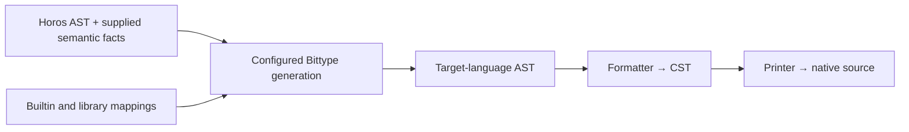

# Generic generation and native admission

**Evaluated proposal, 5 November 2026. No implementation.** This reconciles the
independent consultations [0008](../research-docs/0008-generic-generation-protocol.md)
on composition and [0009](../research-docs/0009-native-kind-constraint-soundness.md)
on native soundness. It refines [plugin generation](type-generation-plugins.md)
and [native constraints](native-kind-constraints.md). Their earlier binder-to-slot
and private-evidence sketches are not alternate supported contracts.

The current pagination implementation still uses its private Dialect. Its
representation profile permits constraint erasure; its enforcement profile
returns Unsupported. Neither the interfaces discussed here nor a new native
admission profile is implemented. The research used source/specification
reasoning, without native compiler runs or a new validation workflow.

The owner's subsequent [Logos preservation proposal](logos-preservation.md)
expresses native admission and representation guarantees as explicit proof
obligations. Its bounded Go pagination example supplies concrete facts, rules
and coverage obligations. This extends the evaluated direction; it does not
claim that the research or current implementation already provides that bridge.

## What is preserved

Keep three relationships separate:

| Relationship | Meaning | Owner |
| --- | --- | --- |
| `Gamma |- S : K` | Source expression S satisfies kind K under the actual assumptions Gamma | Horos |
| `R_c(S) = N` | Configuration c selects native representation N for S | Selected integration mappings |
| `v conforms to S` | A particular runtime value satisfies the canonical description | Outside this types-only proposal |

Native admission must preserve the **intended canonical interpretation**, not
merely find some valid source type that could explain the same native payload.
The association is independent of the membership proof route: proving Person is
Tree or Data must not select different payloads within one configuration.
Membership traits must not each independently choose their own representation.

Soundness means every native application admitted in a declared domain, at its
specified checking point, has the promised source interpretation and association.
Relative completeness means every established source application in an
independently stated supported domain can be expressed with that promise. A
domain cannot be defined as whatever the implementation happens to accept.
Unproved, missing or exhausted judgments supply no admission; an unavailable
native certificate is not a theorem of source nonmembership.

A direct bound on payloads can preserve membership only if source descriptions
that become indistinguishable to that native bound agree on membership in K.
Full injectivity is unnecessary; the relevant representation equivalence classes
must be homogeneous for that particular question. Native expressibility is an
additional requirement. If this condition fails, retain more information or
restrict/reject that representation domain.

## Promises are explicit combinations

Every proposed profile states native argument grammar, permitted consumer
operations, compiler settings, checking point, supported source/composition
domain, identity retention and extension authority.

| Candidate promise | Admission and limits |
| --- | --- |
| Representation | Horos checks source uses; later native payload generics may erase constraints, as explicitly promised today |
| Named applications | Generation exports requested, source-checked applications; adding another application requires source generation |
| Bounded native admission | A declared descriptor/certificate domain is admitted at specified native instantiation or normalization points |
| Retained association | A selected descriptor/wrapper preserves source/configuration identity after admission |
| Trusted extension | Additional generators may issue supported associations under an explicit composition contract; this changes the trust boundary |

These are design categories, not new profile IDs or provider registrations.
Admission followed by alias erasure is different from retaining identity for
later inference, assignment or composition. A wrapper can retain more information
but changes the API. Formation rejection, normalization to an empty result and a
failure only when a type is used are different checking points.

A finite domain can support an open generic over its admitted members. It is
neither arbitrary recursive membership nor permission to replace an unavailable
requested open root with a set of concrete exports. If only generator-produced
consumers are in scope, source analysis supplies much of the guarantee; do not
advertise that as enforcement against arbitrary handwritten native code.

## One generic convention for formals and applications

The common abstraction is a source application with a selected representation
association. Witness types and expanded native parameters are optional encodings.
The kernel must not standardize an S/N/P tuple or learn Horos kinds, Function,
Stream, Cell, or their semantics.

| Component | Responsibility |
| --- | --- |
| Source provider/adapter | Establish and expose admitted uses, memberships and original assumptions |
| Selected mapping | Choose the native representation family |
| Configured source/target convention | Introduce native formals; elaborate actual applications; preserve result associations |
| Target tooling | Native syntax, scopes, anchors, imports and assembly |
| Generation kernel | Exact selection, invocation/scope identity, reservation, lifecycle, budgets and whole-output failure |

Replace the former binder-to-target-index idea with **real source binder to scoped
representation product**. A product includes the native payload projection and
integration-owned support for the chosen association. Support is not necessarily
a public native proof parameter; some profiles need no such parameter.

One immutable convention belongs to the canonical open declaration under the
fixed configuration. Its paired operations are:

- **Introduce:** use reserved native symbols to construct formal products and
  native parameter/constraint syntax. Bind each real source binder exactly once.
  Additional native parameters create no additional Horos binders.
- **Apply:** consume an admitted effective use in the caller's environment and
  construct the complete native application **and its result association**.

Use, Publish and Define share this convention. Apply may reference an owned or
external declaration, or construct inline syntax; it does not imply that every
use must own a local definition. Publication and deferred definition remain
optional capabilities required only when their operation is demanded.
Nongeneric source definitions need an explicit treatment, not an accidental
requirement to implement a generic capability.

The formal/application law is that substituting represented actuals into the
introduced products agrees with representing the corresponding source
substitution. The result law also covers the complete application, assumptions,
required membership support and profile's alias/wrapper promise. Equal type text
or equal IDs cannot establish either law.

### Pagination and scope

This walkthrough is the proposed first implementation through the shared plugin
architecture. The source excerpts assume an explicit import of the ordinary
`horos.kinds` module as `h`; module headers and import identities are omitted.
See [Horos source syntax](horos-syntax.md) for complete module syntax. The
examples specify intended composition, not executed new generator capabilities.

```text
kind Tree = nu {
  X = h.Text | h.Bool | h.List<X> | h.ClosedRecord<X>;
} in X;

type Page<T> = { items: list<T>; next?: text; };
type TreePage<T: Tree>: Tree = Page<T>;

type Person = { name: text; active: bool; };
type People = TreePage<Person>;
```

Tree is an ordinary kind definition. Horos supplies the judgment that Person
belongs to Tree and that TreePage's result belongs to Tree under its original
argument assumption. Generation consumes those established judgments with the
actual source binders; it does not recognize Tree's name or reconstruct its
meaning from the native Person fields.



Resolution and analysis run explicitly before this generation invocation. The
diagram does not permit the host or a mapping to invoke them on demand. The
target AST is the generator's output; source text is produced by the existing
formatter and printer stages.

#### One open declaration, four target representations

The ordinary declaration and record mappings compose the selected list and text
mappings. Page needs no handwritten pagination plugin. One possible composition
retains the existing [pagination representation choices](semantic-generation.md#pagination-subset):

| Target | Page application | `items` type | Optional `next` type |
| --- | --- | --- | --- |
| TypeScript | `Page<T>` | `T[]` | `next?: string` |
| Go | `Page[T]` | `[]T` | `BittypeOptional[string]` |
| Rust | `Page<T>` | `Vec<T>` | `Option<String>` |
| C++ | `Page<T>` | `std::vector<T>` | `std::optional<std::string>` |

These are configured choices, not a language table built into the host. Go's
presence helper and the other optional forms preserve absence separately from
a present value. The TypeScript choice retains the existing strict-null and
exact-optional-property settings. This table concerns representations; it does
not make arbitrary native applications satisfy Tree.

#### Introduce, define and apply

The same configured convention governs the open declaration and every use:

1. **Reserve Page and introduce its formals.** Own reserves the native declaration
   and parameter symbols. Introduce uses those reserved symbols to associate the
   real source binder Page.T with a scoped representation product whose payload
   is the native parameter T. A simple Page convention introduces one native
   parameter.
2. **Define Page's body.** The record mapping requests the selected list mapping
   for `list<T>`. That mapping consumes Page.T's product and constructs the native
   list type. Text and optional-field representation are composed the same way.
   Define fills the reserved declaration with those AST nodes and the already
   chosen native formals.
3. **Apply TreePage to Person.** The source adapter supplies the admitted use
   under its real arguments and assumptions. The selected Person mapping supplies
   its representation. TreePage's convention constructs the complete native
   application using the same layout as its published declaration. It returns
   the result association as well as the native type expression.
4. **Publish People.** Expose the requested named application using that product.
   Retain the open Page and TreePage declarations; the first Person use neither
   chooses their generic signatures nor creates a specialized copy of Page.

Use obtains a representation product; Publish exposes a requested declaration;
Define fills an owned reservation. Introduce and Apply supply the shared generic
convention used by those operations. A mapping selecting an external native
declaration can apply its compatible supplied convention without defining that
declaration locally.

A representation product has two conceptual parts:

| Part | Meaning during generation |
| --- | --- |
| Native payload | Target AST expression for the selected representation |
| Integration-owned support | Information connecting that payload to the effective source use, its assumptions and selected association, including the result support required by composition |

The integration owns the support vocabulary and establishes its association.
The host owns invocation and scope rules; it does not interpret kind proofs or
accept an arbitrary pair as valid merely because its fields have the right Go
types. This is not a universal source/native/proof tuple or a dictionary of named
kinds. Support stays in generation state. An enforcing encoding may additionally
emit native descriptor or constraint types; neither operation creates runtime
adapters or values.

#### Caller scope and nested results

```text
type Outer<T: Tree>: Tree = TreePage<T>;
type Nested<T: Tree>: Tree = TreePage<TreePage<T>>;
```

When defining Outer, TreePage's actual argument is **Outer.T**. Apply consumes
Outer's scoped product; it must not use TreePage's own formal symbols or discard
Outer's assumption. A selected enforcing convention might represent a source
parameter with one descriptor and a payload projection, or with several linked
native parameters. Introduce and Apply must agree on that arrangement.

Nested requires support for the inner **result**. Its inner application produces
the selected native representation of TreePage<T> and the supported result
membership under `T: Tree`. The outer application consumes that product. Reusing
support for T as though it described the whole page is invalid. This requirement
does not authorize hidden source analysis when the supplied facts are missing.

#### Library composition and unused arguments

```text
// Cell is an ordinary imported library declaration.
type EditablePeople = Page<Cell<Person>>;
```

`Page<Cell<Person>>` composes Page's structural/list mappings with Cell's selected
library mapping. It introduces no Data obligation and no Cell-specific kernel
case. The consuming build supplies a mapping for Cell's exact resolved declaration
and the target configuration. For example, an external mapping could supply
`cell.Cell<Person>` in TypeScript, `cell.Cell[Person]` in Go, or
`cell::Cell<Person>` in Rust/C++. These are illustrative library type references,
not new built-in packages. The enclosing Page uses the same open definition and
passes that selected representation as its argument.

The current pagination profile does not thereby gain Wire or Cell support. This
is a future composition fixture requiring an explicit library mapping and its
supported source/target contract. Function and Stream use the same supplied
mechanism. A capability-containing Cell still fails a Data bound regardless of
its native representation, and choosing a native handle supplies no protocol
behavior.

For `Ignore<T: Tree> = text`, source admission must retain T's obligation even
when payload lowering never visits T. Native publication must retain the chosen
admission gate or fail when enforcement is requested. A representation-only
profile must keep its stated source-checking guarantee distinct from native
enforcement. The current backend rejects unused proper parameters; this example
specifies a future requirement, not current support.

### Admission and products do not manufacture proofs

An admitted-use operation would expose coverage already established in supplied
provider results. The current transformer receipt admission establishes
snapshot/profile/configuration/report association. DirectParameterBindings
establishes structural argument correspondence. Neither proves every contextual
membership a new representation might demand.

The current Horos analyzer reuses the resolver's graph and reports. Missing
judgments require an explicitly implemented provider/profile capability and
corresponding receipts; changing a transformer requirement alone creates no fact.
No hidden resolver/analyzer or second Horos evaluator belongs in generation.

The integration must establish the payload/support association before a host
issues a product. Attaching a requested source Ref to an arbitrary pair cannot
make it valid. Host checks concern scope/lifetime; integration checks concern
its own association contract. Trusted Go code and IDs are not a universal
semantic or native-compiler proof.

Products and signatures belong in invocation-local generation state, not the
immutable source Semantics graph. Product reuse must include its target formal
environment. Deferred helpers receive explicit native parameters and their own
scope; retaining an immutable reference to a caller's binder still captures it.
Reservation solves symbol ownership and emission order, not recursive legality.

## Native limits found by the consultations

These are specification-based findings and candidate directions, not compiled
qualifications or promises of delivered capability.

| Target | Correction and proposed initial direction |
| --- | --- |
| TypeScript | An independent evidence parameter bounded above admits `never`, potentially yielding an unrelated inhabited payload. Invariance alone does not fix this. Prefer source-checked names; assess finite selectors of complete applications with explicit union-choice and empty-selection semantics. This is bounded normalization, not unrestricted formation rejection. |
| Go | An exported singleton constraint can expose enough information to infer an unpublished private evidence instantiation. Private naming is not issuance. Source-checked names are the floor; a finite relation of actually issued source/representation tuples is a stronger candidate whose generic expression still needs qualification. |
| Rust | Ordinary alias bounds, demanded associated-type projections and nominal wrappers are different mechanisms. Assess controlled sized descriptors, separate membership/association, and exact normalization/well-formedness points. Neither an unused alias nor a wrapper alone promises earliest rejection everywhere. |
| C++20 | Constrained aliases can retain admission before erasing identity. Assess finite exact complete nongeneric descriptors. Concepts cannot be specialized, but supporting templates can; visibility and extension rules cannot act like late registration. |

Detailed cases and primary references belong in
[native kind constraints](native-kind-constraints.md) and the
[0009 evaluation](../research-docs/0009-native-kind-constraint-soundness.md).
No generic public proof constructor, private spelling or unconstructible runtime
object establishes type-only issuance by itself.

A recursive kind can classify a finite nonrecursive represented type; its
established membership can be one finite fact. A proven recursive source type
still needs a supported native representation. Unknown recursive families built
by native consumers require a separate admission argument. Finite facts, checked
rules admitting arbitrarily many finite constructions, and unrestricted recursive
membership are distinct domains.

## Identity, overrides and imported artifacts

Keep source identity, exact mapping selector, configured BindingID,
representation-association identity and convention/support-contract identity
separate. Start with conservative source-owned identity: pinned declarations,
effective ordered applications and real binders. Different keys do not imply
semantic inequality; source equivalence stays source-owned.

A source-only witness with one global Native<S> projection cannot select two
different representations in the same native environment. Qualify the witness by
association, add a representation-family index, or prohibit incompatible
coexistence. Do not force a universal witness choice into the kernel.

An override can preserve `Person : Tree` while replacing `Person -> N`.
Evidence tied to the old N does not transfer automatically. Conversely, an
imported `Page<T>` genuinely parametric in T may accept a new Person payload.
Its fixed list family, optional-field representation and `next` text do not
change when T changes.

An imported generic therefore needs owner-supplied source/signature identity,
convention/domain and checking-point claims, supported substitutions, result
association, native symbol references and relevant representation/support
dependencies. Compare fixed dependencies and parametric requirements, not the
whole binding table. Unrelated overrides should not invalidate it. Initially,
exact required contract agreement is a conservative rule; other compatibility
claims belong to the integration.

Consumer-owned generation can select new associations and own local admission
artifacts under a justified profile while reusing compatible imported payload
families. Moving the flawed private singleton scheme into a consumer package
does not repair its issuance hole. This avoids
reopening imported sealed headers or handwritten semantic grants. Sealing and
independent extension are separate, sometimes conflicting promises. Reusing a
source theorem means compatible supplied facts or ordinary admission in the new
source world; Horos Program-owned handles are never transplanted between Programs.

These records are explicit producer claims, not proofs or a new provenance
system. Supply them with configured integrations/artifacts initially. ASTSet
contains syntax only; automatic metadata emission would need a separately scoped
artifact/result contract. Do not smuggle it through mutable callbacks, fake AST
nodes or source semantic facts.

## Go SPI status and next scope

The paired-operation/product direction is the evaluated proposal. The expert's
third Go type parameter C and immutable integration token are useful candidate
mechanics, not a finalized public SPI. `C any` cannot itself enforce immutability.
There is no string-keyed universal evidence bag or automatic carrier cloning.

Before implementation, complete these concrete API decisions together for a
selected target/domain:

1. Public issuance and safe access for admitted uses, products, signatures and
   environment identities, without private Bittype imports.
2. One authoritative native formal layout, including preserved constraint clauses
   and exact real-binder coverage.
3. Host-mediated convention application and acquisition of owned/external/inline
   callees; no first-use capture or unconditional Own requirement.
4. Typed support-demand/coverage operations and result association production,
   without enumerating every kind or running hidden analysis.
5. Optional-capability and nongeneric-definition behavior, limits and failure.

### Implementation sequence

The next implementation proceeds through the pagination walkthrough in three
steps. This document authorizes no code change by itself.

1. **Define the public product and convention interfaces.** Resolve the five API
   questions above using Page, Outer and Nested. Independent integrations must be
   able to construct and consume scoped products through public contracts. Keep
   source facts, selected associations and emitted syntax separate; a Go carrier
   cannot establish their semantic correctness by itself.
2. **Replace the private pagination path across all four targets.** Implement the
   shared convention over the existing proper, direct, saturated generic domain
   and supply the ordinary declaration, record, list, text, boolean and optional
   mappings.
   Preserve the existing representation profile's behavior and remove the
   superseded private generation path in the completed replacement. No compatibility
   implementation or implicit fallback remains. Existing unsupported cases stay
   explicit until their own mappings/contracts are implemented. Extend composition
   through ordinary library fixtures such as Cell without adding core cases.
3. **Add supported native constraint encodings.** For each selected target/domain,
   specify the admitted arguments, consumer operations, issuer assumptions,
   checking points and identity/alias promises. Exercise the counterexamples in
   the [constraint proposal](native-kind-constraints.md). An unavailable enforcing
   representation returns Unsupported; no weaker output satisfies that request.

The first implementation retains today's explicit representation-only guarantee.
It preserves the associations needed for stronger encodings without claiming
those encodings already exist. The [Logos preservation proposal](logos-preservation.md)
describes a possible explicit proof integration using source facts, actual target
AST semantics and mapping laws. The product/convention API is not that proof,
and the proposal does not install a Logos dependency or native analyzer implicitly.

The implementation's automated tests and target typechecking should cover:

| Case | Required outcome |
| --- | --- |
| Page and People in each target | One open definition and correctly substituted applications; preserve the selected list and optional representations |
| Outer with renamed source parameters | Resolve the caller's real binder and retain its assumptions; no captured callee formal or name-based substitution |
| Nested constrained application | Compose the inner result's association and required support, not its argument's support |
| Missing source admission or incompatible support | Located failure with no partial output or retry through a weaker mapping |
| Ignore's unused constrained argument | Preserve source admission independently of payload traversal; an enforcing encoding must retain its gate or reject the request |
| Supplied Cell mapping | Compose through the ordinary Page/list mappings without a host, engine, runtime or Wire change |
| Imported generic with compatible/incompatible fixed choices | Reuse only supported parameter substitutions; an element override cannot rewrite a baked-in list or optional representation |
| Requested native enforcing API | Target-specific positive and negative typechecking demonstrates the stated domain and checking point; a few accepted concrete uses do not establish an open guarantee |

These are future acceptance criteria, not tests executed by this documentation
change. Run the applicable Go tests and native typechecking through the
repository's maintained execution paths when implementation is authorized.
Higher-order/computed generics, automatic convention adaptation, mixed native
binders, unrestricted recursion and cross-invocation caches remain deferred
until a concrete supported case requires them.

Any absent admission, incompatible association, omitted bound, illegal scope,
unsupported publication or forbidden wrapper change fails the entire invocation.
There is no retry through an erasing profile or weaker mapping. The engine,
runtime, Wire and hydration gain no knowledge of these library contracts.
