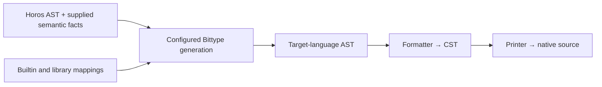

# Generic generation and native admission

**Generic requirements with declarative generation implemented, 8 November 2026.**
This reconciles the
independent consultations [0008](../research-docs/0008-generic-generation-protocol.md)
on composition and [0009](../research-docs/0009-native-kind-constraint-soundness.md)
on native soundness. It refines [plugin generation](type-generation-plugins.md)
and [native constraints](native-kind-constraints.md). Their earlier binder-to-slot
and private-evidence sketches are not alternate supported contracts.

The [public SPI](generation-spi.md) now expresses mapping rules, owned
declaration recipes, public root requests and a single generic convention as
data. Planning resolves those descriptions before native AST construction.
The four generators use this boundary; the former procedural operations,
products and tickets are removed. The representation profile permits constraint
erasure; native enforcement remains unsupported. Research conclusions concerning
stronger admission encodings below remain design requirements, not claims that
the generation SPI implements their proofs.

The owner's subsequent [Logos preservation proposal](logos-preservation.md)
expresses preservation under symbolic assumptions, with native admission proved
separately. Its Go pagination example supplies scoped facts, structural rules
and assumption-discharge obligations for arbitrary `T : Data` with a valid
selected representation. The subsequent
[scoped Horos/Go integration](verification.md#implemented-go-surface) implements
explicit projections and direct Logos checking for TextBox/Page and nested reuse.
That checking composition remains separate from the generation SPI.

The subsequent [type-system modeling proposal](type-system-model.md) makes the
language judgments and rules behind those obligations an explicit design layer.
Specify and exercise that model before finalizing preservation-facing product
and convention interfaces. The pagination walkthrough remains the composition
example; it does not supply the missing native theories by itself.

The [evaluated architecture](type-system-architecture.md) refines that prerequisite:
consume Logos semantic packages and exercise two exact statements and their actual
generation associations. The scoped integration now uses the landed narrow typed
checker. A convention connects source/native binders and whole application
results; the generation plan does not become a proof foundation.
Horos already supports the constructor-arrow query needed for the source guarantee.

## What is preserved

Keep three relationships separate:

| Relationship | Meaning | Owner |
| --- | --- | --- |
| `Gamma |- S : K` | Source expression S satisfies kind K under the actual assumptions Gamma | Horos |
| `R_c(S) = N` | Configuration c selects native representation N for S | Selected integration mappings |
| `v conforms to S` | A particular runtime value satisfies the canonical description | Outside this types-only proposal |

Native admission must preserve the **intended canonical interpretation**, not
merely find some valid source type that could explain the same native payload.
The association is independent of the membership proof route: proving Person is
Tree or Data must not select different payloads within one configuration.
Membership traits must not each independently choose their own representation.

Soundness means every native application admitted in a declared domain, at its
specified checking point, has the promised source interpretation and association.
Relative completeness means every established source application in an
independently stated supported domain can be expressed with that promise. A
domain cannot be defined as whatever the implementation happens to accept.
Unproved, missing or exhausted judgments supply no admission; an unavailable
native certificate is not a theorem of source nonmembership.

A direct bound on payloads can preserve membership only if source descriptions
that become indistinguishable to that native bound agree on membership in K.
Full injectivity is unnecessary; the relevant representation equivalence classes
must be homogeneous for that particular question. Native expressibility is an
additional requirement. If this condition fails, retain more information or
restrict/reject that representation domain.

## Promises are explicit combinations

Every proposed profile states native argument grammar, permitted consumer
operations, compiler settings, checking point, supported source/composition
domain, identity retention and extension authority.

| Candidate promise | Admission and limits |
| --- | --- |
| Representation | Horos checks source uses; later native payload generics may erase constraints, as explicitly promised today |
| Named applications | Generation exports requested, source-checked applications; adding another application requires source generation |
| Bounded native admission | A declared descriptor/certificate domain is admitted at specified native instantiation or normalization points |
| Retained association | A selected descriptor/wrapper preserves source/configuration identity after admission |
| Trusted extension | Additional generators may issue supported associations under an explicit composition contract; this changes the trust boundary |

These are design categories, not new profile IDs or provider registrations.
Admission followed by alias erasure is different from retaining identity for
later inference, assignment or composition. A wrapper can retain more information
but changes the API. Formation rejection, normalization to an empty result and a
failure only when a type is used are different checking points.

A finite domain can support an open generic over its admitted members. It is
neither arbitrary recursive membership nor permission to replace an unavailable
requested open root with a set of concrete exports. If only generator-produced
consumers are in scope, source analysis supplies much of the guarantee; do not
advertise that as enforcement against arbitrary handwritten native code.

## One generic convention for formals and applications

The common abstraction is a source application with a selected representation
association. Witness types and expanded native parameters are optional encodings.
The kernel must not standardize an S/N/P tuple or learn Horos kinds, Function,
Stream, Cell, or their semantics.

The [Go certificate proposal](go-native-admission.md) selects `(S,N,E)` as one
such convention. Its [admission theorem](type-system-architecture.md#native-admission-remains-independent)
concerns that complete tuple, with source identity supplied by S and the selected
S/N association supported by E. Its empty private marker methods are an explicit
[extension beyond types/interfaces-only emission](type-system-architecture.md#go-marker-method-scope-extension),
not an existing generator capability or a required convention for other targets.

| Component | Responsibility |
| --- | --- |
| Source interpretation | Classify declarations, name descriptors and judge declarations and whole uses from supplied evidence |
| Selected mapping | Choose the native representation family |
| Configured source/target convention | Introduce native formals; elaborate actual applications; preserve result associations |
| Generation target | Native declaration syntax, lexical scopes, anchors and bound uses; the [Files formatter](source.md#from-generated-declarations-to-files) owns concrete imports and exports |
| Generation kernel | Capture and scope identity, substitution, budgets and whole-output failure; the registry supplies exact selection and the invariant planner resolves dependencies |

One immutable convention belongs to the open declaration under the selected
configuration. The implemented contract is:

```go
type GenericConvention[T any] struct {
    Parameters []ParameterDescription
    Bindings   []Expression[T]
    Arguments  []Expression[T]
}
```

The mapping library supplies it. The planner pairs Bindings with real source
formals, substitutes Argument(i) expressions using effective actuals and
constructs the complete native application. Parameters owns the native parameter
list; adding a native parameter creates no additional source binder.
An external mapping can instead directly describe its complete native
application using captured source slots, without defining the library type.

For example, a source parameter T may bind to native Parameter(0), while
Arguments supplies both Argument(0) and a native collection of Argument(0).
That selects NativePage<T, Collection<T>> consistently for open and nested uses.
The independent-source fixture exercises exactly this additional-parameter case.
[Independent fixture](../integration/go/testdata/generationfixture/fixture.go)

A stronger enforcing convention may also require integration-owned support for
membership and source/native association. That is not supplied by an arbitrary
native expression or inferred from a Go carrier. Its representation and proof
contract require separate qualified implementation. The current program retains
scope and the complete represented result, not a universal source/native/proof
tuple or an untyped support bag.

The formal/application law remains: substituting represented actuals in the
open native family must agree with representing the corresponding admitted
source substitution. Equal names or equal rendered type text do not prove it.
Native constraint encodings must additionally retain the profile's assumptions,
membership support and alias/wrapper promise.

### Pagination and scope

This walkthrough explains the shared plugin architecture now used by the
four production generators.
The source excerpts assume an explicit import of the ordinary
`horos.kinds` module as `h`; module headers and import identities are omitted.
See [Horos source syntax](horos-syntax.md) for complete module syntax. The
pagination structure is implemented; stronger native constraint encodings in the
examples remain proposals.

```text
kind Tree = nu {
  X = h.Text | h.Bool | h.List<X> | h.ClosedRecord<X>;
} in X;

type Page<T> = { items: list<T>; next?: text; };
type TreePage<T: Tree>: Tree = Page<T>;

type Person = { name: text; active: bool; };
type People = TreePage<Person>;
```

Tree is an ordinary kind definition. Horos supplies the judgment that Person
belongs to Tree and that TreePage's result belongs to Tree under its original
argument assumption. Generation consumes those established judgments with the
actual source binders; it does not recognize Tree's name or reconstruct its
meaning from the native Person fields.



Resolution and analysis run explicitly before this generation invocation. The
diagram does not permit the host or a mapping to invoke them on demand. The
target AST is the generator's output; source text is produced by the existing
formatter and printer stages.

#### One open declaration, four target representations

The ordinary declaration and record mappings compose the selected list and text
mappings. Page needs no handwritten pagination plugin. One possible composition
retains the existing [pagination representation choices](semantic-generation.md#pagination-subset):

| Target | Page application | `items` type | Optional `next` type |
| --- | --- | --- | --- |
| TypeScript | `Page<T>` | `T[]` | `next?: string` |
| Go | `Page[T]` | `[]T` | `BittypeOptional[string]` |
| Rust | `Page<T>` | `Vec<T>` | `Option<String>` |
| C++ | `Page<T>` | `std::vector<T>` | `std::optional<std::string>` |

These are configured choices, not a language table built into the host. Go's
presence helper and the other optional forms preserve absence separately from
a present value. The TypeScript choice retains the existing strict-null and
exact-optional-property settings. This table concerns representations; it does
not make arbitrary native applications satisfy Tree.

#### Plan the declaration and apply its convention

1. The declaration recipe selects Page's native parameters and binds the real
   source Page.T to its native parameter expression.
2. The record expansion records its fields. The list rule selects the native
   collection of that scoped parameter; optional text composes its supplied rules.
3. An application admits all source actuals, maps those demanded by the native
   convention and substitutes their complete representations. Person and nested
   Page results remain distinct expressions.
4. The requested People alias refers to that application. The planner retains
   one open Page definition; no concrete caller selects its signature.
5. Run allocates symbols, constructs all planned declarations and binds each
   use to its intended parameter, owned declaration or public external symbol.

The scoped expansion request expires when its callback returns. The resulting
closed program retains parameter/declaration identities independently of that
callback's lifetime. Helpers use their own opaque key and parameter scope.
[Exact declaration and expansion contracts](generation-spi.md)

#### Caller scope and nested results

```text
type Outer<T: Tree>: Tree = TreePage<T>;
type Nested<T: Tree>: Tree = TreePage<TreePage<T>>;
```

When defining Outer, TreePage's actual argument is **Outer.T**. Substitution consumes
Outer's scoped expression; it must not use TreePage's own formal symbols or discard
Outer's assumption. A selected enforcing convention might represent a source
parameter with one descriptor and a payload projection, or with several linked
native parameters. The formal and application templates must agree on that arrangement.

Nested requires support for the inner **result**. Its inner application produces
the selected native representation of TreePage<T> and the supported result
membership under `T: Tree`. The outer application consumes that product. Reusing
support for T as though it described the whole page is invalid. This requirement
does not authorize hidden source analysis when the supplied facts are missing.

#### Library composition and unused arguments

```text
// Cell is an ordinary imported library declaration.
type EditablePeople = Page<Cell<Person>>;
```

`Page<Cell<Person>>` composes Page's structural/list mappings with Cell's selected
library mapping. It introduces no Data obligation and no Cell-specific kernel
case. The consuming build supplies a mapping for Cell's exact resolved declaration
and the target configuration. For example, an external mapping could supply
`cell.Cell<Person>` in TypeScript, `cell.Cell[Person]` in Go, or
`cell::Cell<Person>` in Rust/C++. These are illustrative library type references,
not new built-in packages. The enclosing Page uses the same open definition and
passes that selected representation as its argument.

The default pagination profile does not thereby gain Wire or Cell support. The
[composition fixture](generation-composition.md#extension-examples-and-qualification)
adds an explicit library-owned Cell mapping and its supported native contract. Function and Stream use the same supplied
mechanism. A capability-containing Cell still fails a Data bound regardless of
its native representation, and choosing a native handle supplies no protocol
behavior.

For `Ignore<T: Tree> = text`, source admission must retain T's obligation even
when payload lowering never visits T. Native publication must retain the chosen
admission gate or fail when enforcement is requested. A representation-only
profile must keep its stated source-checking guarantee distinct from native
enforcement. The default structural recipe rejects unused proper parameters; this example
specifies a future requirement, not current support.

### Admission and products do not manufacture proofs

The source's use judgment reports coverage already established in supplied
provider results. The current transformer receipt admission establishes
snapshot/profile/configuration/report association. DirectParameterBindings
establishes structural argument correspondence. Neither proves every contextual
membership a new representation might demand.

The current Horos analyzer reuses the resolver's graph and reports. Missing
judgments require an explicitly implemented provider/profile capability and
corresponding receipts; changing a transformer requirement alone creates no fact.
No hidden resolver/analyzer or second Horos evaluator belongs in generation.

An enforcing integration must establish its representation/support association;
attaching a source reference to arbitrary data cannot make that association true.
The generation kernel checks scope and captured identity. Native interpretation
and proof meaning remain independently owned.

Native expressions and declaration IDs belong to the planned program, not to the
immutable source Semantics graph. Substitution preserves the target parameter's
declaration scope. Native helpers receive explicit parameters; immutable
references to a caller's binder would still be an illegal capture. Reserving a
symbol does not establish recursive type legality; cycles remain unsupported
in the implemented generation profile.

## Native limits found by the consultations

These are specification-based findings and candidate directions, not compiled
qualifications or promises of delivered capability.

| Target | Correction and proposed initial direction |
| --- | --- |
| TypeScript | An independent evidence parameter bounded above admits `never`, potentially yielding an unrelated inhabited payload. Invariance alone does not fix this. Prefer source-checked names; assess finite selectors of complete applications with explicit union-choice and empty-selection semantics. This is bounded normalization, not unrestricted formation rejection. |
| Go | An exported singleton constraint can expose enough information to infer an unpublished private evidence instantiation. Private naming is not issuance. Source-checked names are the floor; a finite relation of actually issued source/representation tuples is a stronger candidate whose generic expression still needs qualification. |
| Rust | Ordinary alias bounds, demanded associated-type projections and nominal wrappers are different mechanisms. Assess controlled sized descriptors, separate membership/association, and exact normalization/well-formedness points. Neither an unused alias nor a wrapper alone promises earliest rejection everywhere. |
| C++20 | Constrained aliases can retain admission before erasing identity. Assess finite exact complete nongeneric descriptors. Concepts cannot be specialized, but supporting templates can; visibility and extension rules cannot act like late registration. |

Detailed cases and primary references belong in
[native kind constraints](native-kind-constraints.md) and the
[0009 evaluation](../research-docs/0009-native-kind-constraint-soundness.md).
No generic public proof constructor, private spelling or unconstructible runtime
object establishes type-only issuance by itself.

A recursive kind can classify a finite nonrecursive represented type; its
established membership can be one finite fact. A proven recursive source type
still needs a supported native representation. Unknown recursive families built
by native consumers require a separate admission argument. Finite facts, checked
rules admitting arbitrarily many finite constructions, and unrestricted recursive
membership are distinct domains.

## Identity, overrides and imported artifacts

Keep source identity, exact mapping selector, registry-qualified binding reference,
representation-association identity and convention/support-contract identity
separate. Start with conservative source-owned identity: pinned declarations,
effective ordered applications and real binders. Different keys do not imply
semantic inequality; source equivalence stays source-owned.

A source-only witness with one global Native<S> projection cannot select two
different representations in the same native environment. Qualify the witness by
association, add a representation-family index, or prohibit incompatible
coexistence. Do not force a universal witness choice into the kernel.

An override can preserve `Person : Tree` while replacing `Person -> N`.
Evidence tied to the old N does not transfer automatically. Conversely, an
imported `Page<T>` genuinely parametric in T may accept a new Person payload.
Its fixed list family, optional-field representation and `next` text do not
change when T changes.

An imported generic therefore needs owner-supplied source/signature identity,
convention/domain and checking-point claims, supported substitutions, result
association, native symbol references and relevant representation/support
dependencies. Compare fixed dependencies and parametric requirements, not the
whole binding table. Unrelated overrides should not invalidate it. Initially,
exact required contract agreement is a conservative rule; other compatibility
claims belong to the integration.

Consumer-owned generation can select new associations and own local admission
artifacts under a justified profile while reusing compatible imported payload
families. Moving the flawed private singleton scheme into a consumer package
does not repair its issuance hole. This avoids
reopening imported sealed headers or handwritten semantic grants. Sealing and
independent extension are separate, sometimes conflicting promises. Reusing a
source theorem means compatible supplied facts or ordinary admission in the new
source world; Horos Program-owned handles are never transplanted between Programs.

These records are explicit producer claims, not proofs or a new provenance
system. Supply them with configured integrations/artifacts initially. ASTSet
contains syntax only; automatic metadata emission would need a separately scoped
artifact/result contract. Do not smuggle it through mutable callbacks, fake AST
nodes or source semantic facts.

## Go SPI status and next scope

The [current public contract](generation-spi.md) is declarative.
The invariant interpreter lives beside its immutable Program contract; registry
selection lives in the shared transform stage. Mapping libraries depend on native
semantic forms; targets consume those forms without a source reader or mapping
callbacks. [Implemented boundaries](generation-planner.md#three-spi-changes)

### Implementation sequence

1. **Implemented:** immutable mapping descriptions and source-scoped expansion,
   automatic exact selection/explicit replacements, generic substitution and
   helper planning. A runnable plan contains every reachable target expression.
2. **Implemented:** separate native construction for TypeScript, Go, Rust and C++,
   Output sealing, and TypeScript Files placement from that output. Page<Cell>,
   a reversed two-operand external mapping and an independent source with an
   extra native parameter exercise the public contracts.
3. **Deferred:** native constraint encodings, independently qualified for each
   supported domain, issuer model and checking point. The representation profile
   does not enforce arbitrary handwritten native applications.
4. **Implemented:** kernel-owned traversal of established semantics
   ([GEN-01](generation-gaps.md#gen-01)). **Deferred:** the remaining native
   Files cases.

[Plan tests](../integration/go/generation_planning_test.go) ·
[Independent source](../integration/go/generation_independent_test.go) ·
[Four-target pagination](../integration/go/horos_generation_pagination_test.go)

Qualification of stronger native admission must still cover ignored source
arguments, nested result support, fixed dependencies of external generics,
alias/wrapper promises, and both rejected and admitted native consumers.
The [joint verification composition](verification.md) checks scoped TextBox/Page
claims using actual captured artifacts; neither a generation plan nor its native
parameter count is that proof. No runtime, Wire or hydration contract changes.
