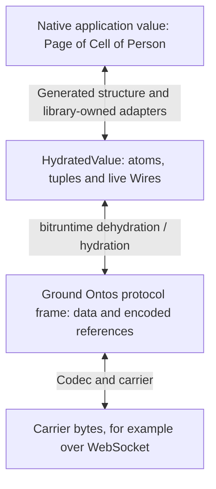

# Type generation, runtime values and hydration

**Owner direction, 3 November 2026. Status: documentation only.** This page
connects the [static representation proposal](type-representations.md) to the
existing Wire/runtime value boundary. It distinguishes inspected implementation
from future adapters and dynamic interpretation. It adds no source, dependency,
runtime interface, generator, binding or release.

Ground Ontos and Horos stay data-only. Optional ontos/wire is the separate mixed
value profile; optional horos/wire describes its types. Bittype supplies their
tooling projections. Existing bitwire contracts and bitruntime hydration already
carry capabilities; alignment with the optional profiles is future work.
Function, Stream and Cell declarations, representations and behavior remain library-owned.

## 1. Type descriptions and application values are different inputs

The current generation proposal transforms descriptions:

```text
AST[Horos or HorosWire] -> AST[Go] -> CST[Go] -> Go source
```

Both ASTs are ordinary Go values describing types. A description of Page<Person>
can produce syntax declaring Page[Person]; this operation does not produce a
particular page or person. The Go implementation language of the generator is
independent of the language of its output.

Runtime conversion instead acts on instances:

```text
wire.HydratedValue <-> Page[Person]
wire.HydratedValue <-> Page[Cell[Person]]
```

The second application uses the separately derived contract Page and its chosen
native representation; it is not a capability argument passed into a Horos data
declaration. [Template lifting](type-representations.md#2-embedding-and-lifting-are-explicit-different-operations)
changes the type description under an explicit profile, while a runtime adapter
converts an actual instance according to that description and representation.

| Object being represented | Go representation and status |
| --- | --- |
| Horos type declarations | Existing Horos model and `horos.AST`, the alias for `ast.AST[horos.Language]` in Bittype's Horos syntax package. |
| Mixed type declarations containing Wire | Implemented Go horos/wire model and `horoswire.AST` projection; see [the frontend guide](horoswire.md). |
| Go source describing types | Existing `golang.AST`, the alias for `ast.AST[golang.Language]`. |
| Ground application data | Existing Ontos Atom/Tuple values through the relevant Go `Value` type. |
| Application data containing live capabilities | Existing `wire.HydratedValue`, admitted and constructed by a conforming runtime; future ontos/wire alignment is not yet implemented. |
| The application's native object | Its compiled Go type T, such as Person, Page[Person] or a selected Cell[Person] representation. |

The [AST carrier](ast.md) and [checked AST envelope](engine.md#identity-profiles-and-storage)
represent syntax, not application objects. A Go AST describing Person is not a
Person, and neither ASTTransformer nor the formatter is a runtime value adapter.

There is no need for a second universal `bittype.Value` algebra or a Go-value AST
between the existing hydrated domain and native T. Descriptors can themselves be
encoded as ground Ontos data, but their being data does not make the described
instances data-only or perform any capability binding.

### Optional value-profile alignment

The proposed [ontos/wire profile](https://github.com/Bitspark/ontos/blob/main/docs/design/0007-optional-wire-extension.md)
places the common mixed-value meaning outside Bittype. It is a recognized subset
of Deixis nodes with byte, tuple and opaque capability cases. An eventual Go
presentation may parameterize the capability carrier; it must not depend on
Bitruntime or import Bitwire merely to obtain an interface. Runtime composition
supplies recognized sending handles and retains authority/lifetime ownership.
Static type tools need only ground descriptions, not the live value carrier.

The current `wire.HydratedValue` is not already an implementation of that new
package or an alias for Deixis. Future alignment must establish a law-preserving
view or conversion, with immutable bytes/children and retained handle aliasing.
It need not allocate a second tree for every message. A pure traversal of
`Tuple(w, w)` retains both occurrences of the same handle without sending,
exporting, cloning or rebinding it. Export identity is still a runtime concern.

Ground recovery succeeds only for admitted wire-free values and uses the existing
Ontos codec for bytes. Dehydrating a live value instead needs a runtime scope and
may stage exports; it is not the profile's pure recovery operation. Reference-like
application data remains data. Neither a profile member nor a Send-shaped object
alone establishes an exportable capability, remote liveness or message compliance.

Thus a future native adapter may consume the qualified realization of ontos/wire
while preserving the responsibilities illustrated below. Its exact native API
must be chosen with runtime integration; the existing interfaces remain the
source evidence, and the illustrative Adapter sketch is not a new dependency pin.

## 2. Existing Go Wire and value contracts

The following evidence is pinned source inspection, not a fresh deployment or
package-release verification:

| Inspected source | Relevant implementation |
| --- | --- |
| bitwire `e2d2d641744a49f1d8098b6ea5f2724454d72b96` | [Ground Wire](https://github.com/Bitspark/bitwire/blob/e2d2d641744a49f1d8098b6ea5f2724454d72b96/wire/go/wire.go), [hydrated Go contracts](https://github.com/Bitspark/bitwire/blob/e2d2d641744a49f1d8098b6ea5f2724454d72b96/wire/go/hydrated.go), [pure hydrated codec](https://github.com/Bitspark/bitwire/blob/e2d2d641744a49f1d8098b6ea5f2724454d72b96/wire/go/hydrated_codec.go). |
| bitruntime `64dbe709f2f002781a5010b08a6650c7eeb129df` | [Go endpoints, scopes, exports and proxies](https://github.com/Bitspark/bitruntime/blob/64dbe709f2f002781a5010b08a6650c7eeb129df/hydrated/go/hydrated.go) and [runtime/component evidence](https://github.com/Bitspark/bitruntime/blob/64dbe709f2f002781a5010b08a6650c7eeb129df/hydrated/README.md). |

With `ontos` used as the import alias, the existing interfaces distinguish:

```go
type Wire interface {
    Send(ontos.Value) error
}

type HydratedWire interface {
    Send(HydratedValue) error
}
```

In this bitwire revision, the ground Go type is supplied by its pinned
`github.com/Bitspark/bitwire/ontos/go/core` consumer package. This notation does
not assert Go type identity with another package's presentation of Ontos; an
integration must use the actual selected dependency types.

Go currently declares `type HydratedValue = any`, but its admissible domain is
restricted to ground Ontos atoms/tuples, finite immutable hydrated tuples and
runtime-recognized hydrated Wires. It is not permission to send arbitrary Go
structs, cyclic objects or any value implementing a Send method. The runtime
owns capability recognition. A ground Wire cannot become a HydratedWire by a
type cast; their message domains differ.

`Wire<E>` in the proposed horos/wire profile describes a message contract. The
existing Go `wire.HydratedWire` interface is not parameterized by E. A future
selected native view can expose typed sending by composing E's value adapter;
the hydrator itself does not load E or check a library's message protocol.

A Wire grants sending only. An Endpoint owns receiving and closure. Send success
means local admission, not a remote operation result or delivery acknowledgement.
In particular, hydrated Send does not implement Function invocation or matching.

### Using the existing runtime boundary

The following are existing Go operations, with roles established by the selected
runtime composition rather than by a type description:

| Operation | Use and ownership |
| --- | --- |
| `hydrated.NewEndpoint(limit)` | Create an owned local endpoint with a bounded delivery queue. |
| `endpoint.Receive(handler)` | Attach its one receiver; the handler receives a hydrated value and composition-established ReceivedContext. The returned detach operation is separate from closing the endpoint. |
| `endpoint.Wire()` | Obtain the sending face. Convey this capability, not receiving or closure authority. |
| `hydrated.NewTuple(...)` | Capture value children and project owned endpoints to sending faces. Wholly ground tuples remain ordinary Ontos tuples. Construction sends nothing. |
| `target.Send(value)` | Send through a local face or imported proxy. Actual arguments/results remain the owning library's protocol. |
| `endpoint.Close()` | End the owned endpoint and withdraw its exports; a borrowed sending face does not grant this operation. |
| `hydrated.NewScope(...)` | Establish a participant's hydration state over the supplied addressed sender and namespace; runtime/network composition supplies routing. |
| `scope.Expose(endpoint)` / `scope.Connect(reference)` | Bootstrap a known exported endpoint and obtain its sending proxy. These are composition operations, not calls each domain adapter makes. |
| `scope.Deliver(path, frame, context)` | Route an incoming addressed ground frame through the scope to its exported endpoint, decoding the hydrated body first. |
| `scope.Close()` | End this scope's exports and references without closing domain endpoints. Composition owns the scope lifetime separately from endpoint/adapter lifetimes. |

Application composition or a library's explicit lifetime owner retains and
closes the endpoints it creates. A request/reply library may put a reply sending
face inside a request and close its owned endpoint after the declared completion
or failure path. Merely returning from Send does not establish that completion.
No new request/reply convention is defined by these methods.

## 3. Where hydration happens



The top conversion is future generated/library adapter work. The lower hydrated
boundary already exists in the inspected runtime. The destination uses the same
layers in reverse, potentially in a different programming language.

On a remote send:

1. A native adapter represents T as a hydrated value. For a callable, its
   library may create an owned endpoint implementing its protocol and place the
   endpoint's sending face in that value.
2. Bitruntime traverses the complete value, stages exports for recognized local
   capabilities and represents Wire leaves by namespace-scoped references. It
   preserves data and rejects invalid/foreign values under its protocol limits.
3. Bitwire's pure hydrated codec constructs a ground frame from structural data
   and reference descriptors. The runtime commits the staged exports before
   admitting the frame to the addressed sender. A carrier encodes/transports
   ground values; WebSocket is one carrier.

On receipt, the runtime validates/unpacks the frame, checks its destination
scope/export, reconstructs hydrated tuples and sending proxies, then dispatches
the value to the endpoint's receiver. A library adapter interprets that value as
its chosen native T. A reference returning to its current local owner can recover
the original sending face; receiving a capability does not recover the owner.

The Go mechanisms are `Scope.toData`, `Scope.fromData`, `Scope.Deliver` and
`Scope.importRef` in the pinned implementation. The pure codec's intermediate
`wire.HydratedData` contains reference descriptors, not live Wires. Pack/unpack
does not itself create exports, resolve authority or prove liveness. A proxy's
remote liveness is judged when it is used, not guaranteed by decoding it.

The representation keeps ordinary reference-shaped application data as data;
hydration follows explicit protocol tags/cases, not a search for matching tuples.
Whole-value staging and bounds belong to the shared runtime. A lower admission
refusal may leave newly committed exports live until their owner closes, under
the existing bounded ownership law; adapters must not infer rollback or remote
completion from a transport outcome.

Local delivery can keep values hydrated without serializing a network frame.
Bitnode can assemble routing/scopes, but is not a requirement for every local
pair or direct connection. A transit router can forward ground frames without
interpreting domain values. None of these layers needs Person, Function, Cell or
Stream semantics, nor a Horos/Bittype type descriptor to reconstruct generic Wire proxies.

## 4. Proposed native value adapters

Later bindings could expose the following shape. This is illustrative Go, not
an implemented interface or a chosen package/API:

```go
type Adapter[T any] interface {
    ToValue(ctx BindingContext, value T) (wire.HydratedValue, error)
    FromValue(ctx BindingContext, value wire.HydratedValue) (T, error)
}
```

BindingContext stands for explicitly supplied resource/lifetime facilities.
Its exact methods, ownership receipts, acquisition/failure cleanup and retained
view rules require a separate runtime-binding design. It is not the existing
`wire.ReceivedContext`: that is composition-established arrival information
passed beside a message, not an endpoint factory or proof supplied by its data.
The sketch is not a complete resource-lifecycle contract.

A data-only adapter uses the ground subset and converts according to the
declared Horos type and selected native representation. A capability adapter
can materialize an owned endpoint or construct a native view over a received
capability. The declared message type does not prove remote adherence; the
library owns message checks and protocol failure behavior.

The adapter does not generate export IDs, construct transport references or
replace the scope's hydration engine. Conversely, hydration never selects the
native representation of a Person or implements get/set on a Cell.

Generic composition can be expressed schematically as:

```text
PageAdapter(PersonAdapter)
PageAdapter(CellAdapter(PersonAdapter))
```

The Page adapter traverses its record/list and delegates elements. For the
[proposed structural Cell](hydrated-types.md#4-library-owned-function-cell-and-stream),
Cell's binding composes its get/set Function representations. Function's library
owns invocation, matching, outcomes and reply lifetime. The Stream library owns
its demand/end/cancel laws. Other custom representations use their own explicitly
selected library bindings through the same mechanism.

When a native API produces or accepts T on later calls, its parameter conversion
must occur on those calls. Constructing a Cell view does not eagerly read the
cell, snapshot its future values or duplicate a provider invocation. Directions,
failures and owned/borrowed lifetimes must be preserved by the owning library.

The existing [Cell composition fixture](https://github.com/Bitspark/bitruntime/blob/64dbe709f2f002781a5010b08a6650c7eeb129df/hydrated/ts/test/fixtures/cell.mjs)
and [consumer observations](https://github.com/Bitspark/bitruntime/blob/64dbe709f2f002781a5010b08a6650c7eeb129df/hydrated/ts/test/COMPOSITION.md)
demonstrate that kind of bidirectional generic composition over the shared
hydrated layer. They are authored TypeScript consumer fixtures with their own
Cell-of-Wire convention, including nested cells. They are not generated bindings
for the proposed canonical Cell record, a production universal adapter API or
proof of every future contract's laws.

## 5. Runtime use and dynamically received type descriptions

A generated adapter executes at runtime even when its types were known during
generation. It can return a compiled Go Person because both Person and the
matching adapter are part of that program. Native representation choices are
explicit; a descriptor alone does not pick one of several possible Go types.

A different case is a type description first received after the program starts.
A future dynamic tool can inspect that resolved description and retain its
instance generically as:

```text
(resolved type description, HydratedValue)
```

This is a conceptual pairing, not a new public value type, transport envelope,
validation certificate or runtime implementation. Data-only instances remain
ground. A description of a Wire is itself data, not a live capability; usable
capabilities come from the runtime's admitted endpoint/reference mechanisms.

Receiving a description does not create a new statically usable named Go type
or methods. To return a concrete Person, the program needs an available compiled
type and an explicitly compatible adapter. Otherwise it retains a generic value
and uses a dynamic view/interpreter if one is provided. Reflection can have
separate, bounded uses; it is not an automatic implementation of every named
type, generic application or library protocol.

Any future dynamic interpreter still receives explicit library binding choices
and resolves exact declaration identities. Unknown or unsupported bindings fail;
there is no automatic loading by type name, shape-selected protocol or fallback
claim that an arbitrary `any` is a validated T. Retaining a description beside a
value does not prove conformance, liveness or behavioral compatibility.

## 6. Generation and runtime remain separate composition layers

An expression such as `adapterToGo(bittype): gotype` must distinguish these
three operations and the kind of input each receives:

```text
Type generation:
  type description + native representation -> Go declaration AST -> source

Future binding generation:
  resolved descriptions + selected library bindings -> adapter source

Runtime conversion:
  Adapter[T] + hydrated instance + binding context -> native T (or error)
  Adapter[T] + native T + binding context -> hydrated instance (or error)
```

The existing native AST/text profiles cover type declarations, not executable
adapter bodies. Generating such bodies requires separately scoped target syntax,
checking, formatting and compiler qualification. This proposal does not extend
those profiles or permit raw-source injection to bypass them.

The static [library type recipes](type-representations.md#4-ordinary-libraries-and-optional-native-representations)
select native types/imports and build type-only ASTs. They are not executable
value adapters. Future binding generation can emit static imports and compose
the matching library adapter factories, preserving the selected contract and
representation identities. Recipes for types and for runtime behavior must be
qualified together where behavior is required; successful compilation alone is
insufficient.

The generator remains implemented in Go. Generated Go adapters would execute in
Go; generated TypeScript, Rust or C++ adapters would execute in their own target
environment and require that environment's actual runtime/library support. A
type-only declaration is not evidence that all those runtime realizations exist.

No runtime value carrier or adapter is added to the agnostic AST/CST, semantic
model, engine, formatter or printer. The engine's language-pair registry remains
for AST transformation. Generated consumers depend on their selected libraries
and Wire/runtime facilities; those lower facilities never import a catalogue of
Function, Stream, Cell or future contracts. This document adds no bitwire or
bitruntime dependency to bittype and selects no new runtime package layout.

Current implemented tooling and optional-profile lifting, the unimplemented native transformations,
and these future value bindings remain separately qualified work. Adding a
dynamic descriptor does not authorize changing Horos's data domain, choosing a
behavioral contract by shape or reviving a second hydration/export protocol.
