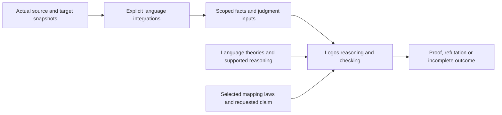

# Type-system models and preservation reasoning

**Evaluated proposal, 5 November 2026. Documentation only.** The owner requested an explicit
model for describing Horos and native type systems before implementing native
constraint-preservation reasoning. This is the next design prerequisite for the
[Logos preservation proposal](logos-preservation.md) and the preservation-facing
parts of the [generic generation design](generic-elaboration.md).

The [expert-reviewed implementation design](type-system-architecture.md) refines
ownership: use Logos's semantic-package direction directly, with language-owned
theories and an explicit Bittype generation/claim association. Do not introduce
a separate Bittype type-system framework or proof foundation. The first design
artifacts are the exact TextBox and Page statements and their dependencies.

No type-system interpreter, Logos bridge, native analyzer, generator change or
runtime binding is implemented here. Examples are proposed rules and expected
reasoning outcomes, not executed proofs or compiler results. Public integration
contracts remain to be designed; foundation statements follow Logos's admitted
contract rather than a new Bittype serialization.

## Purpose and current boundary

Describe type systems through their terms, binding rules, judgments and inference
rules. Then use those models to answer questions within one language and to
establish properties of selected mappings between languages. The common model
must accommodate different language theories without making their meanings
identical or requiring every language to implement every judgment.

This follows the logical-framework idea of representing formal systems and their
derivations in shared machinery; see [Harper's explanation](https://www.cs.cmu.edu/~rwh/research.html).
It does not select LF or another new dependency as an implementation.

| Layer | Existing responsibility | Proposed addition |
| --- | --- | --- |
| AST/CST | Language syntax, references, layout and source emission | None in this document |
| Bittype Semantics | Immutable provider-owned facts, entities, terms and bindings | Explicit bridges to the judgments needed by a selected type-system model |
| Language providers | Horos resolution/analysis; native syntax tooling | Native semantic models and explicitly supported reasoning capabilities |
| Type-system theories | No native type theories are implemented here | Language-owned semantic packages using the proposed Logos model |
| Mapping integrations | Proposed representation selection and composition | Representation laws relating the actual source and target terms |
| Logos integration | Proposed consumer of facts and laws | Evaluation and checking of supported claims under the supplied theories |

The [current semantic graph](semantics.md) is a fact carrier, not a type-system
interpreter. Its common storage does not establish the facts' truth. This
proposal adds language-owned theory integrations above that boundary; it does
not replace the graph, Horos's type model, the generic AST, or the existing
analysis/result separation. Shared proof-language machinery belongs to Logos.

## What describes a type system

A model consists conceptually of the following parts. These are requirements for
language integrations and Logos semantic packages, not fields of a new shared
Bittype model or implemented Go struct.

| Part | Required meaning |
| --- | --- |
| Configuration | Language version, relevant compiler options, module/package environment and permitted consumer operations |
| Term vocabulary | Language-owned types, kinds, constraints, constructors, applications and any additional static terms the fragment needs |
| Binding and context | Declaration identity, lexical scope, real parameter binders, capture-avoiding substitution and local assumptions |
| Judgment vocabulary | Explicitly named and typed questions with declared meanings and argument domains |
| Rule modules | Inference rules, equations, side conditions and admitted foundational theories that justify judgments |
| Coverage | Supported syntax, queries, argument domains, extension mechanisms and checking points |
| Reasoning support | Which derivations, decision procedures or certificates can establish each supported claim |

The vocabulary is extensible. Rust may need lifetime or const-parameter terms;
C++ may need static-expression terms for a selected constraint fragment. Such
additions belong to the language model. They do not create cases in Logos or
Bittype's generic engine. A static function-type constructor likewise does not
install the library-owned Function protocol.

Keep three forms of variables distinct: binders in the source language, binders
in the target language, and logical variables in a rule. Source `T` and target
`T` are different declarations even when spelled alike. A rule must relate their
substitutions explicitly. Renaming a binder cannot change its judgment, and
substitution must not capture another binder or discard its assumptions.

A context identifies the actual captured inputs, assumptions, dependencies and
configuration. Existing snapshot and reference contracts provide the starting
point. No new checksum, provenance record or whole-configuration digest is
required by this proposal. Horos Program handles remain local to their Program;
another context needs compatible supplied evidence or ordinary fresh admission.

## Judgments and rules

Useful judgment roles include:

| Judgment role | Question |
| --- | --- |
| Well-formedness | Is this declaration or type expression admissible in this context? |
| Kind membership | Does this type description or constructor satisfy this kind? |
| Equality and normalization | Do these expressions denote the same type under the language's rules? |
| Subtyping | Does this language establish its particular subtype relation? |
| Assignability | Does this language allow this source type at this destination? |
| Constraint satisfaction | Does this argument meet this parameter's requirement? |
| Application | Is this generic use admissible, and what result does it denote? |
| Additional language relations | For example, trait implementation, associated-type normalization or lifetime outliving |

These are reusable roles for language-owned judgment declarations, not a closed
enum or mandatory methods on every provider. Equality, subtyping, assignability,
kind membership and constraint satisfaction are distinct relations. One language
may relate some of them by a rule; the framework must not equate them globally.
The coarse proper/constructor sort in the current semantic graph is not a full
kind contract.

Illustrative judgment notation is:

```text
world; assumptions |- judgment(arguments)
```

A rule declares its quantified variables, premises, conclusion and side
conditions. The language theory owns what those expressions mean. Binding,
freshness, normalization, visibility and extension restrictions cannot be left
as unmodeled implementation details when they affect the promised answer.

For example, the Go model's exact, non-interface type-term fragment needs a rule
that relates constraint membership to Go type identity. The Horos model instead
relates a type description to an ordinary kind definition. These rules can share
the rule machinery while remaining different theories.

For closed concrete Go argument A and a valid non-interface exact term B, a
candidate model law is:

```text
go.satisfies(W, A, exact(B))  iff  go.identical(W, A, B)
```

That fragment's two-way characterization supplies more than a list of successful
examples. A schematic Horos result rule instead has this form:

```text
horos.admitted_application(W, Gamma, F, A)
horos.constructor_guarantee(W, Gamma, F, K_in, K_out)
horos.member(W, Gamma, A, K_in)
--------------------------------------------------
horos.member(W, Gamma, apply(F, A), K_out)
```

The application still needs admission under its original contracts; the result
guarantee does not replace that requirement. These are illustrative theory
statements, not new Logos syntax or implemented predicates. Their exact encoding
and side conditions must follow the owning language semantics. Names such as
go.satisfies and horos.member belong to those theory modules, not either kernel.

A model must account for all operations allowed by its claimed consumer domain.
An example limited to closed concrete generic arguments cannot silently claim
coverage of symbolic forwarding, inference through function assignments or
downstream extension. Some native obligations require static contexts beyond the
current declaration AST subset. Naming the language does not imply that those
contexts are already modeled.

Vocabulary and rule modules should be declarative, library-owned content. Go
providers supply extraction, orchestration or supported decision-procedure
boundaries where needed; language rules must not become switches hidden in the
general host.

## Ownership and relationship to Logos

| Owner | Responsibility |
| --- | --- |
| Horos and its integration | Authoritative declaration/kind meaning and the bridge to corresponding judgments; no second generator-owned Horos evaluator |
| Native language integration | Terms and rules for an explicit native fragment, plus correspondence with actual native syntax and dependencies |
| Logos semantic-package and checking contracts | Reusable typed judgments, proof contexts, evidence rules, abstraction/substitution and checking; richer production contracts remain proposed |
| Type-owned mapping library | Selected representation equations and composition laws, including builtin mappings |
| Bittype orchestration | Explicitly select providers and keep inputs, facts, candidate ASTs, mappings and results associated |
| Logos | Execute/check supported reasoning through its general model and extension points |

Concrete theories and the optional association/checking adapters remain separate
from generic carriers and registrations. The [package-role plan](type-system-architecture.md#proposed-package-roles)
preserves the root Go module and stage-first matrix. Begin with a private seam
exercised by the two exact statements, then design the public contract. This
document requires no repository split or dependency change; optional Go packages
do not by themselves isolate module dependencies.

Distinguish object-language meaning, foundation soundness, validity of particular
evidence and adequacy to actual artifacts/native behavior. Source binders, native
binders and proof variables need a checked correspondence. A shared record or
identical spelling supplies none. The [four assurance boundaries](type-system-architecture.md#four-assurance-boundaries)
and [statement binding](type-system-architecture.md#binding-and-the-expected-statement)
make these obligations explicit.

Language theories and mapping laws are ordinary Logos consumer content. Logos
does not gain Data, Page, Go, TypeScript, Function, Stream or Cell predicates as
kernel-owned meanings. This preserves its [domain-blind boundary](https://github.com/Bitspark/logos/blob/main/docs/architecture/decisions/0025-logos-is-domain-blind.md).
Horos's Data and other named kinds remain ordinary definitions interpreted by
Horos, rather than reserved branches in the modeling layer.

The [Logos account contract](https://github.com/Bitspark/logos/blob/main/docs/spec/logos-contract.md#derivation)
already distinguishes rule derivations, builtin theories and admitted leaves.
Its finite ground proof DAG does not automatically prove an arbitrary universal
claim merely because that claim can be named by a ground atom. The design must
identify the actual reasoning route:

- A supported rule derivation establishes a particular judgment.
- A declared complete finite domain can support exhaustive coverage reasoning.
- A generic theorem requires justified reasoning under its assumptions, such
  as supported generalization or induction; several ground examples are insufficient.
- Recursive judgments require their declared fixed-point semantics. Horos's
  greatest-fixed-point kind reasoning cannot be replaced by ordinary least-model
  Horn recursion or by a cycle in an otherwise acyclic proof DAG.
- An existing decision procedure may supply an admitted leaf/theory result under
  an explicit contract. This makes that procedure a stated foundation; it is not
  independent replay of its reasoning in Logos.

The current Horos checker can be a starting source of established judgments, as
the [preservation proposal](logos-preservation.md#integration-and-outstanding-obligations)
explains. A future certificate exporter could support stronger replay. Neither
bridge exists for the proposed general-kind preservation claims today. The model
must expose this distinction instead of presenting assumed facts as derived ones.
Public Horos no longer includes its earlier private-history Logos bridge.
Its existing constructor-arrow query and immutable public inspection are sufficient
source operations; the [new evidence bridge](type-system-architecture.md#the-authoritative-source-guarantee)
must translate their actual results and original assumptions.

The selected next route is a [narrow Logos-owned typed checker](type-system-architecture.md#the-logos-checking-prerequisite)
for signatures, contexts, abstraction, substitution, theorem application and exact
statement checking. Logos owns that milestone's admission. Its current richer
foundation is experimental, not a production dependency. A separate consumer
certificate calculus remains an explicitly justified alternative, not the default.

## Questions, mappings and outcomes

Within a language, ask the appropriate judgment: whether a Horos type belongs to
a kind, a Go argument satisfies a constraint, or a Rust obligation is established.
A cross-language question additionally needs an intended interpretation and a
selected representation relation. Similar syntax or equal-looking structure
does not supply either.

For a source declaration H, target declaration G, configuration c and declared
native application-argument domain D, the preservation obligation is schematically:

```text
for every a in D:
    NativeAccepts(G, a)
        implies SourceAccepts(H, Interpret_c(a))
        and Represents_c(SourceResult(H, Interpret_c(a)), NativeResult(G, a))
```

Native acceptance includes the specified checking point. Interpret_c must give
the intended source application for every accepted case in the claimed domain;
it cannot choose any convenient source type after seeing the desired conclusion.
Here a contains the complete arguments of the selected convention. In the
[Go admission proposal](go-native-admission.md), a is `(S,N,E)`: a source-identity
token, native payload and certificate type. The source interpretation comes from
S, while the justified admission relation checks E's association with S and N.
It is not an inverse of the native payload mapping. The
[architecture's tuple admission statement](type-system-architecture.md#native-admission-remains-independent)
states the corresponding obligation without imposing that tuple on other
languages or the kernel.
Where a contract deliberately interprets unions as choices, that interpretation
must be stated rather than confused with a canonical union descriptor.

Relative completeness is a separate obligation: every source application in an
independently declared supported source domain has an admitted corresponding
native representation. Rejecting everything is not a useful preservation result.
Membership, representation correctness and runtime value conformance remain
separate. A type-level guarantee does not validate arbitrary application values
or establish the behavior of a library protocol.

The Go certificate convention also proposes a limited
[marker-method emission extension](type-system-architecture.md#go-marker-method-scope-extension)
beyond types and interfaces. Its empty method bodies support native admission;
they add no runtime proof checking. Production emission remains unimplemented.

Query results distinguish:

| Result | Meaning |
| --- | --- |
| Proven | The requested claim follows from the stated model and admitted premises |
| Refuted | An established negation of the requested claim or an admissible counterexample defeats it |
| Unproved | The available assumptions/reasoning do not establish either requested conclusion |
| Unsupported | The requested construct, operation or reasoning capability is outside the declared coverage |
| Exhausted | A resource limit prevented completion |
| Invalid input | The request, reference or input association is malformed |

Unsupported, exhaustion and invalid input are execution/coverage outcomes, not
logical nonmembership. This follows the existing separation in the
[analysis contract](analysis.md) and Horos's judgment API; it is not a new
implemented result enum. Invalid evidence does not refute its requested claim;
certificate validity and language/preservation judgments are separate obligations.
The [outcome boundary](type-system-architecture.md#outcomes-and-trust) preserves
that distinction, including binary leaf hooks and completion-aware theories.
Missing proof is not false. Negation needs an explicit
justification, such as a justified complete domain, rather than search failure.

## Worked example: Horos TextBox and Go constraints

The source excerpt assumes an explicit import of `horos.kinds` as `h`:

```text
type TextBox<T: h.Text> = { value: T; };
type Label = TextBox<text>;
```

For this example, the selected associations are canonical text to Go string and
canonical bool to Go bool. The requested positive source domain is the canonical
text argument. The Go model uses an explicit Go 1.25 language baseline.
The candidate claim concerns closed concrete type arguments in a fixed package;
symbolic forwarding and arbitrary extension require additional modeled rules.

These assumptions do not identify all named source declarations or consumer
overrides with the same representation. They also do not claim that every Go
string value satisfies Horos's UTF-8 value conformance.

### Candidate A: unconstrained native parameter

```go
type TextBox[T any] struct {
    Value T
}
```

The proposed model should derive the following counterexample from ordinary
language rules and the supplied associations:

```text
Go: TextBox[bool] is an admitted application.
Selected interpretation: Go bool denotes canonical bool here.
Horos: bool does not belong to h.Text.
Therefore the candidate does not preserve TextBox's argument restriction.
```

Horos nonmembership is an established source judgment, not the absence of a
positive membership fact. Go acceptance is derived from the actual parameter
constraint, not a plugin's declaration that it emitted an unconstrained generic.
No special TextBox rule or declaration-name switch is needed.

### Candidate B: an exact native constraint

```go
type TextBox[T interface{ string }] struct {
    Value T
}

type StringAlias = string
type NamedString string
```

The model for this fragment must justify the complete accepted domain using
[Go type identity](https://go.dev/ref/spec#Type_identity),
[general-interface type sets](https://go.dev/ref/spec#General_interfaces) and
[constraint satisfaction](https://go.dev/ref/spec#Satisfying_a_type_constraint).
The expected distinctions are:

| Argument | Expected application judgment | Reason |
| --- | --- | --- |
| string | Accepted | It is the exact type named by the constraint |
| StringAlias | Accepted | The alias denotes that same Go type identity |
| bool | Rejected | It is outside the exact type set |
| NamedString | Rejected | A defined type has a distinct identity despite its underlying string type |

The proof needs the converse as well: every accepted closed concrete argument
has that identity. These four cases alone are not an exhaustive proof. The
language-model lemma characterizes the domain; the selected interpretation then
connects it to canonical text. Relative completeness concerns the stated source
domain, not every future mapping of a named source declaration.

Changing the constraint to `~string` changes the admitted domain. NamedString
would then be admitted, requiring an applicable intended interpretation and
representation association. Sharing an underlying type does not create those
associations automatically; missing support is not an established source
counterexample, and the broader constraint is not inherently unsound. Generic
inference and forwarding must be assessed when included in the requested consumer
operations.

### Result representation is another obligation

Even a correct argument restriction does not establish that Value represents
the source field. The structural mapping must account for:

- The source field `value` and target field `Value`, through an explicit field binding.
- The required field's presence and selected element representation.
- The correspondence of the source and target parameter binders.
- Substitution of actual arguments into both bodies.

These are instances of ordinary record, parameter and application laws. The
desired top-level preservation claim cannot simply be supplied as a primitive
fact. A future account establishes it only after the admission and result
obligations are discharged. No such account or compiled example is delivered
by this document.

## Pagination and generic guarantees

```text
type Page<T> = { items: list<T>; next?: text; };
type DataPage<D: h.Data>: h.Data = Page<D>;
type Person = { name: text; active: bool; };
type People = DataPage<Person>;
type Nested = DataPage<DataPage<Person>>;
```

The model should express Page's result guarantee under the requested assumption
that its argument belongs to Data, while preserving its original contracts and
without treating Data as a special kind.
The list, record and optional-field rules compose that result. Source and target
parameter identities remain distinct; their substitutions must correspond.

Horos can already check the existing Page constructor against a particular
resolved arrow kind `K => K`; it retains the original parameter bounds and body.
An existing DataPage alias is another source of the relevant conditional facts,
not a mandatory helper or a second Page. The missing [trusted source-schema
bridge](type-system-architecture.md#the-authoritative-source-guarantee) translates
that authoritative result into the selected evidence foundation.

The [symbolic Go proof](logos-preservation.md#prove-preservation-under-symbolic-assumptions)
uses arbitrary source and native parameters, with two explicit assumptions:
`T : Data` and a valid selected representation `Rep_C(T,N)`. Structural laws
derive the source result guarantee and corresponding native result; lawful
assumption discharge makes that theorem reusable. Nested pagination uses the
inner application's result proofs as the outer application's premises. It does
not require a finite catalogue of permitted argument types.

[Native admission](logos-preservation.md#native-admission-is-separate) remains
independent: an enforcing target must establish those premises for every
argument it admits. Conditional generic preservation alone neither supplies that
gate nor promises a mapping for every Data type. Person above illustrates a use;
it does not bound the theorem's domain.

The [generation walkthrough](generic-elaboration.md#caller-scope-and-nested-results)
therefore still needs scoped products and result support. The proposed model
explains and justifies that support; attaching it to a product is not itself a
proof. Ignored parameters also retain their source obligations, even when the
native payload contains no reference to them.

Mapping laws are configuration-relative. An imported Page with a fixed list or
optional representation cannot acquire another representation through an element
override. A genuinely parametric element slot can accept a new compatible element
mapping. This distinction belongs to the model and the supplied export contract.

## How the five languages fit

The shared structure is intended to describe all five languages, starting with
explicit fragments. It does not claim complete formalization or decision
procedures for every language feature.

| Language | Model obligations | Initial boundary or counterexample |
| --- | --- | --- |
| Horos | Ordinary kind definitions, type formation, binding/application, conditional result guarantees and the correct recursive-kind semantics | Reuse authoritative judgments; distinguish Proven, Refuted and Unproved; no Type/Data name cases or least-fixed-point replacement |
| Go | Nominal identity versus aliases/underlying types, exact and approximate type sets, constraint satisfaction, package boundaries and relevant inference | Start with exact constraints over closed concrete arguments; model the private-singleton inference counterexample before claiming broader issuance |
| TypeScript | Structural assignability separately from identity, strict settings, never/any, variance, conditional/mapped types, unions and relevant declaration merging | Independent upper-bound evidence admits never; property-based evidence has mapped-bottom counterexamples. Finite selector normalization is a different promise from formation rejection |
| Rust | Trait obligations, associated-type normalization, alias checking points, Sized/dyn, coherence/sealing and relevant lifetime/variance conditions | A demanded projection gate and an ordinary alias bound have different guarantees; sizedness must hold at the effective gate, not merely be written on an alias |
| C++ | Template argument binding, constraints/requires, identity and alias substitution, specialization, visibility and required static evaluation | Constrained aliases over a controlled finite descriptor domain are candidates; supporting-template customization and changing constraint satisfaction must be accounted for |

The [native constraint proposal](native-kind-constraints.md) supplies the detailed
language findings and primary references. A model cannot avoid a known
counterexample by silently omitting an operation admitted by its promise. Either
include the relevant rule or explicitly narrow the supported consumer domain.
Adding a language-specific judgment, such as Rust outlives, must not require a
new case in the shared generation host or Logos kernel.

## Pipeline and model adequacy

The proposed reasoning path is:



Native observations must describe the actual candidate AST, its dependencies and
the relevant consumer operations. Facts about a hand-selected subset of fields
or permitted arguments do not establish a claim about the whole output. An
ASTTransformer currently returns syntax; a future proof-bearing result needs an
explicit result/evidence contract. Do not hide accounts in AST nodes or mutate
the source semantic graph to record a generated representation.

There are two different obligations: establish a theorem in the supplied model,
and justify that the model describes the claimed language/compiler behavior.
Omitting aliases, inference or extension rules can make the first succeed while
the second fails. The native specification is the semantic basis; targeted
compiler acceptance/rejection tests can expose model mistakes but do not prove
the entire model or compiler correct. Formatting and printing must also preserve
the target declarations whose properties were established.

The framework should support proof and counterexample discovery without
promising a terminating decision procedure for every query. A search limit or
missing reasoning capability cannot become an enforcing success or a logical
refutation. Universal claims, recursion and inference need their actual supported
reasoning principles, not only a convenient representation as data.

## Design and qualification sequence

The [evaluated implementation sequence](type-system-architecture.md#implementation-and-qualification-sequence)
starts from two exact statements and their actual artifact associations. It
supersedes designing an independent shared framework before the examples.

1. Specify TextBox admission/result representation and Page's quantified
   composition theorem, with their domains, original assumptions and selected
   mapping dependencies. Use language-owned judgments in Logos semantic packages.
2. Exercise a private Bittype association seam and a concrete TextBox
   counterexample. Characterize the complete admitted Go fragment and its
   source/target correspondence; several successful examples do not prove coverage.
3. Obtain the Logos-owned typed check-only prerequisite for lawful abstraction,
   substitution and exact statement checking. Define the trusted Horos schema
   bridge through existing authoritative operations, without a duplicate evaluator.
4. Check one symbolic Page theorem and its nested instantiation, then stress
   the model with the TypeScript, Rust and C++ distinctions. Promote only the
   public integration contract that the examples show necessary.
5. On implementation authorization, run binding, rule, negative mutation and
   native typechecking tests for the declared domains and adequacy direction.
   Portable workloads use maintained shared/CI execution; all Logos workloads
   stay off this workstation. No unsupported checking route grants a stronger claim.

The [generation sequence](generic-elaboration.md#implementation-sequence) remains
the subsequent composition plan. Public proof integration and target enforcement
must not be inferred from the existing representation-only path.

This documentation performs none of those software or proof executions. The
current pagination representation profile continues to permit constraint erasure;
its enforcing profile continues to return Unsupported. No native semantic
provider capability, automatic proof path or runtime behavior is added.

## Forbidden shortcuts

- A universal type algebra that replaces Horos or equates every native type with
  a Horos descriptor before its semantics are modeled.
- Kernel cases for particular languages, named kinds or Function/Stream/Cell.
- A single compatibility predicate that silently conflates equality, subtyping,
  assignability, kind membership and value conformance.
- Treating unknown membership as false, several passing instances as a universal
  theorem, or a chosen list of arguments as an exhaustively characterized domain.
- Declaring the desired preservation conclusion as a foundational axiom or
  accepting a mapping's self-reported guarantee as proof of its actual output.
- Replacing greatest-fixed-point reasoning with ordinary Horn recursion, hidden
  analysis, or a duplicated Horos checker inside generation.
- Reusing another input's facts, transplanting Program-owned handles, or carrying
  old representation evidence across an incompatible mapping override.
- Advertising a model proof as proof of arbitrary compiler behavior or runtime
  value/protocol conformance.
