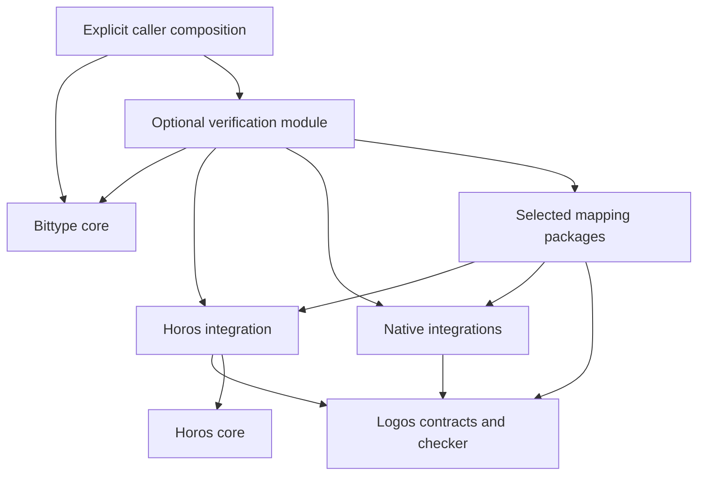

# Advice for consult
**Research doc:** doc_d799c49f-8580-4342-a6f1-cf7005119237.md
**Document:** doc_d799c49f-8580-4342-a6f1-cf7005119237
**Advisor:** ChatGPT, model "6 Pro" as labelled on the answer page
**Session:** nsess_b68f9798-d04e-4799-8160-0fb33240c869
**Run:** run_e274981d-8f47-46db-b52c-1f0b931b567d
**Chat:** https://chatgpt.com/c/6aecee9c-0440-83eb-8f5d-0cc4a7ca8c0a
**Verify:** nightfall consult verify run_e274981d-8f47-46db-b52c-1f0b931b567d --output <this file>

## Recommendation

**Use Logos’s semantic-package direction directly. Keep Bittype responsible for associating claims with actual generation inputs and outputs, and put the first symbolic proof behind a small Logos-owned checking boundary.**

I would revise the proposal around three decisions:

1. **Do not introduce a new Bittype-owned type-system modeling framework.** The seven proposed concerns are useful requirements, but most already belong to language integrations or Logos. The genuinely missing Bittype concern is the explicit association between a requested statement, the actual generated declarations, the selected mappings, and the evidence.
2. **Make a narrow typed-checker milestone in Logos the prerequisite for production symbolic certification.** It need not include general proof search, a package registry, or complete native-language theories. It must check contexts, abstraction, substitution, theorem application, and the exact requested statement.
3. **Qualify two separate promises:** conditional representation preservation for `Page`, and native admission enforcement. The proposed `Page[N any]` family can satisfy the former without establishing the latter.

I am treating the pinned repository excerpts in [Research 0010](https://chatgpt.com/library?file_id=libfile_f9f7fb974d4c8191a89c5ccbd5c36b08&account_id=personal) as the implementation baseline. I could not independently retrieve the linked GitHub sources, and this response does not claim that the proposed proofs or qualification tests have been executed.

## 1. What should become a Logos consumer?

The architectural unit should be a **language-owned semantic package plus an elaborator that connects actual artifacts to that package**. A shared representation of “types in general” would provide little assurance and would risk flattening the distinctions the document carefully preserves.

I would distribute the seven proposed concerns as follows.

| Concern | Semantic owner | Shared responsibility |
|---|---|---|
| Language configuration and module environment | Language integration | Bittype binds the exact configuration to the request and result. |
| Types, kinds, lifetimes, constants, and other static objects | Language integration | Logos represents well-typed references and expressions under the selected foundation. |
| Object-language binding and substitution | Language integration | Logos owns binding and substitution in the evidence language. The integration establishes their correspondence. |
| Judgment declarations and meanings | Language or mapping integration | Logos checks applications of those declarations. |
| Inference rules, equations, and side conditions | Their semantic owner | Logos checks evidence under an explicitly admitted foundation and dependencies. |
| Coverage | Language integration and service implementation | The caller can inspect whether representation, execution, and certification are supported for the requested claim. |
| Derivations, procedures, and certificates | Evidence producer and designated checker | Bittype preserves association, provenance, completion, and trust information. |

### Keep the four kinds of assurance separate

The proposal should explicitly distinguish:

- **Object-language semantics:** what Horos membership, Go constraint satisfaction, Rust normalization, or TypeScript assignment means.
- **Proof-foundation soundness:** why the admitted logical rules preserve truth.
- **Evidence validity:** whether this particular proof or certificate establishes this exact statement under its declared dependencies.
- **Model adequacy:** whether the modeled judgments describe the actual language, compiler profile, and artifacts being used.

A successful proof check establishes the third item relative to the first two. It does not automatically establish the fourth.

This distinction matters even for a small Go fragment. An internally correct proof about an elaborated declaration is useless if elaboration omitted a constraint, confused an alias with a definition, or associated the proof with a different emitted helper.

### Binding needs correspondence, not a common record type

There are at least three distinct identities in the pagination example:

1. Horos’s original `ParameterID{declaration, slot}`.
2. The generated native declaration’s formal parameter.
3. The variable introduced in the proof context.

The mapping integration must establish their correspondence. A common `Binder` structure would not establish it.

Logos should own proof-context operations such as abstraction and substitution. Horos should continue to own opening and applying Horos declarations. The native integration should own the corresponding native operations. A binding map connects those operations and must preserve their meaning.

This also prevents a subtle mistake: **logical context extension is different from changing a native-language environment**. Adding a proof assumption may be structurally admissible. Adding a declaration, specialization, implementation, or merged interface can change a native judgment. Native environments should therefore be explicit objects in statements, with their own extension policies.

### The reusable boundary that is missing

The missing boundary is an association of the following form:

> Check this statement about these exact source and target artifacts, under these semantic-package instances, mappings, assumptions, and consumer conditions.

That is narrower than a type-system framework. It can initially be private integration code. I would promote a public abstraction only after TextBox and Page have both exercised it.

## 2. Ownership, dependencies, and a small Go-facing seam

### Dependency direction

I recommend an explicitly optional integration module. The following graph shows dependencies; the Logos checker dependency may be implemented through a process protocol.



The existing Bittype dependencies on Horos and Ontos remain. Horos core retains its existing neutral dependency boundary. Neither Horos core nor Logos needs to import Bittype, and Logos does not acquire a list of supported languages.

A practical package-role layout would be:

| Location | Role |
|---|---|
| Logos | Foundation checking, statement/evidence contracts, signature admission, dependency accounting, and completion-aware checking. |
| Optional Horos integration | Language-owned judgments; translation of authoritative Horos results; preservation of original assumptions; eventual certificate export or replay. |
| Native-language integrations | Native semantic vocabulary, artifact elaboration, supported judgments, compiler profiles, and adequacy documentation. |
| Type-owner mapping packages | Selected representation relation, family definitions, primitive composition laws, fixed imports, and their justifications. |
| Optional Bittype verification module | Capture actual output; bind source/output/configuration; construct the expected statement; invoke checking; publish associated outcomes. |

These are roles, not proposed permanent directory names.

There is a packaging decision worth making explicitly: **an optional Go package inside Bittype’s existing module still changes that module’s requirements if it imports Logos**. If preserving Bittype’s current module dependency boundary matters, use a separate integration module. Package isolation alone does not provide module isolation.

### Keep the transformer boundary initially

The existing transformer can continue returning syntax. An explicit wrapper can:

1. Admit the supplied source evidence as today.
2. Freeze the selected mapping configuration.
3. Invoke the transformer.
4. Capture the actual output and all relevant generated helpers.
5. Construct the requested source/output statement.
6. Request evidence checking.

The frozen mapping configuration must come from actual selection. It cannot be reconstructed afterward from emitted type names.

A preservation result for one transformation leg remains distinct from target semantic evidence. A later leg needs its own actual input/output association and whatever target judgments it requires.

### A private interface sketch

The integration seam can refer to Logos statements without copying Logos’s proposed expression and context model into Bittype:

```go
// Illustrative private integration types, not proposed exported APIs.
type CheckRequest struct {
    Source    semantic.Snapshot
    Output    ASTSnapshotRef
    Manifest  BindingManifestRef
    Expected  StatementRef
    Candidate EvidenceRef
    Policy    TrustPolicyRef
}

type CheckOutcome struct {
    Binding    BindingID
    Completion Completion
    Claim      ClaimVerdict
    Evidence   EvidenceVerdict
    Basis      JustificationRef
}

type Checker interface {
    Check(context.Context, CheckRequest) (CheckOutcome, error)
}
```

The essential invariant is that **`Expected` is constructed independently of the candidate evidence**. A proof cannot choose a weaker claim, a different output, or a more convenient interpretation.

The binding manifest should identify:

- The canonical source inputs, dependency closure, declaration identities, and original parameter slots.
- The actual target declarations and helpers, target environment, language profile, and relevant options.
- The selected mappings and their fixed imports, binder correspondence, interpretation, domain, checking point, consumer operations, and extension policy.
- The foundation, semantic-package instances, admitted laws, trusted procedures, and checker identity.

If the user-facing claim covers emitted files, association must extend to those files. A theorem about an AST does not automatically cover a printer’s output.

### Separate invalid evidence from a false claim

The result model needs these distinctions:

| Event | Meaning for the requested preservation claim |
|---|---|
| Valid proof checked under accepted dependencies | Established relative to those dependencies. |
| Valid counterexample checked | Refuted within the stated domain. |
| Malformed or incorrectly associated certificate | This evidence is invalid; the claim remains undetermined. |
| Horos `Unproved` or checking exhaustion | Incomplete; no logical negation follows. |
| Unsupported syntax, judgment, or checker capability | Unsupported; no logical negation follows. |
| Compiler/model disagreement | The adequacy of the affected model profile is challenged. |

The existing `Report` boundary need not be reinterpreted. If a report concerns certificate validity, rejection concerns that certificate. It must not be silently reused as rejection of source membership or preservation.

### Mapping ownership does not make a law true

A type owner may select a representation and publish laws about it. Each law still needs an exact proposition and either checked evidence or a visible assumption accepted by the requester.

Builtin mappings should follow the same path.

For an imported Page mapping, the selected list, optional-field, and record mappings are part of the theorem instance. An element override cannot silently replace those fixed dependencies. Representation evidence is configuration-specific even when source membership evidence remains reusable.

## 3. The reasoning route for symbolic pagination

### Recommended route: promote a small Logos checker

I recommend a **Logos-owned, check-only typed interface**, with a thin Go client invoking a versioned checker process on shared or CI workers.

That is an explicit dependency choice. The test-private Rust foundation described in the document is a starting point for this milestone, not an existing service or stable Go library.

The milestone should support only what the first proofs need:

- Checked signatures and ordered contexts.
- The selected dependent-function, pair, and equality fragment.
- Abstraction, assumption discharge, substitution, and theorem application.
- Exact comparison between the requested statement and the checked proof type.
- Explicit assumed dependencies and their transitive provenance.
- Bounded checking with distinct invalid, incomplete, and unsupported outcomes.
- Versioned serialization and a small process protocol.

It does **not** require general proof search, complete language theories, general inductive declarations, automatic package discovery, or the entire proposed semantic-package production surface.

Before promotion, the Page package and proof can be exercised as a research/conformance demonstration. Production symbolic certification remains unsupported until the checker and required package imports are admitted. That is a concrete, limited prerequisite rather than an indefinite wait for the whole Logos roadmap.

### The exact theorem

Let:

- \(H_C\) be the language-owned domain of admitted source proper types.
- \(G_C\) be the supported native type domain.
- \(K\) be the resolved ordinary kind referred to as `h.Data`.
- \(P_H\) be the actual source Page family.
- \(P_G\) be the actual generated Go Page family.

The central statement is:

\[
\begin{aligned}
\mathsf{page}_C:\quad
\forall T:H_C.\ \forall N:G_C.\quad
&\mathsf{Member}(T,K)
\to \mathsf{Rep}_C(T,N)\\
&\to
\bigl(
\mathsf{Member}(P_H(T),K)
\land
\mathsf{Rep}_C(P_H(T),P_G(N))
\bigr).
\end{aligned}
\]

Formation requirements belong in the domains or explicit premises. The `Rep` premise must have the promised native well-formedness meaning.

The selected logical fragment is sufficient for this proof shape. Universal quantification and implication can use dependent functions; conjunction can use pairs. The first proof can operate over abstract language-owned object domains and admitted laws without introducing a general inductive definition of every source and native type.

Using logical functions in evidence does not add source type lambdas or partial application to Horos.

A proof has this schematic form:

```text
lambda T, N, member_T, rep_T_N.
  pair(
    source_page_membership(T, member_T),
    named_record_representation(
      actual_source_body,
      actual_target_body,
      list_representation(rep_T_N),
      optional_text_representation,
      exact_field_correspondence
    )
  )
```

Every operation in that expression must have a checked type and a justified meaning. The final theorem itself must not appear as an assumed mapping law.

### Where the source membership proof comes from

For the first slice, I would reuse authoritative Horos declaration admission.

The checked declaration

```text
DataPage<D: K>: K = Page<D>
```

provides a route to a source-only conditional schema: under its original argument contract, its actual body satisfies the declared result guarantee.

An optional Horos bridge could export that schema as a **trusted authoritative-procedure result**. This would be new integration work. The current sealed handles and query API do not already constitute a portable symbolic proof API.

The bridge contract must preserve:

- The complete admitted declaration.
- Its real parameter identities and every original parameter contract.
- The actual body under those binders.
- The body/result-guarantee association.
- Canonical modules, imports, and relevant procedure configuration.
- Correct reconstruction of Program-owned handles during replay.

A closed `Satisfies` call cannot establish this schema by testing several instances. Nor can the bridge manufacture a fresh ground atom and pretend it is a symbolic Horos `TypeValue`.

If existing public inspection cannot expose the required association, the missing addition is a minimal authoritative inspection/export capability. It is not a license to duplicate Horos’s checker in generation.

This route gives an independently checked **composition proof relative to a trusted Horos source-schema procedure**. It does not claim an independent proof of Horos’s implementation.

Later, Horos may export closure theorems or certificates that reduce this trusted dependency. Those should be established from the resolved ordinary kind definition; `Data` remains an ordinary package constant.

### Representation requires actual family correspondence

The representation proof must establish more than correspondence between two anonymous record shapes.

It needs:

- Correct opening of the source family under its original binder.
- Correct instantiation of the native family under its own binder.
- Correspondence of all actual fields.
- The selected list/slice law.
- The optional-field/helper law.
- A justified rule connecting the named native declaration to the representation relation.

In particular, do not replace the native named type with its anonymous body using a fabricated native equality. A representation relation can permit distinctions that native type identity preserves.

`Page`, `Items`, `Next`, and `BittypeOptional` are not authoritative merely because their spellings match the proof template. Their bound declarations and meanings must match.

### What makes generalization lawful?

Use real context variables and construct the abstraction inside the foundation checker.

The checker must ensure:

1. The source and native parameters are well-scoped and correctly sorted.
2. The membership and representation assumptions are explicit.
3. Every referenced theorem and procedure result is valid in that context.
4. No local assumption or hidden parameter dependency escapes.
5. Substitution is capture-avoiding and preserves the evidence’s type.
6. The abstracted proof has exactly the requested quantified type.

A fact about one specially named atom cannot be generalized merely because the atom was freshly allocated. For example, a builtin that recognizes that atom’s spelling would invalidate substitution to arbitrary types.

This is why universal introduction, implication introduction, instantiation, and oracle dependency tracking belong to the foundation boundary. Established proof-kernel interfaces distinguish these operations explicitly. [isabelle.in.tum.de](https://isabelle.in.tum.de/website-Isabelle2021-1/dist/doc/implementation.pdf?utm_source=chatgpt.com)

No separate global parametricity theorem is needed for this Page proof if the proof is an explicitly checked abstraction and its imported laws have the required uniform types.

### Nested reuse

Suppose the package has:

\[
d_P:\mathsf{Member}(\mathsf{Person},K)
\]

and

\[
r_P:\mathsf{Rep}_C(\mathsf{Person},\mathsf{GoPerson}).
\]

Applying `page_C` produces both:

\[
d_1:\mathsf{Member}(P_H(\mathsf{Person}),K)
\]

and

\[
r_1:\mathsf{Rep}_C(P_H(\mathsf{Person}),P_G(\mathsf{GoPerson})).
\]

Those are the arguments for the next application of the same theorem. Nested pagination follows by ordinary theorem application.

The integration must still connect actual `DataPage` applications to this family and satisfy their original contracts. An ignored parameter remains subject to its declared constraint. A weaker desired result does not relax the original application.

Research 0008’s proposed operations fit this:

- `Introduce` associates actual source/native formals with proof-context entries.
- `Apply` supplies actual arguments and evidence for original obligations.
- Result support carries the resulting statements and their application association.
- The outer application consumes the inner membership and representation results.

No enumeration of `T` is involved.

### Native admission is another theorem

For an enforcing native family, an additional statement is needed:

\[
\mathsf{NativeAccepts}_C(N)
\Rightarrow
\left(
\mathsf{Member}(\mathsf{Interpret}_C(N),K)
\land
\mathsf{Rep}_C(\mathsf{Interpret}_C(N),N)
\right).
\]

Its domain, checking point, and permitted operations must be independently fixed. The interpretation must cover every accepted case in that domain.

Composing this statement with `page_C` yields the intended end-to-end guarantee. `Page[N any]` alone does not supply those premises.

A domain restricted to arguments already accompanied by `Data` evidence is legitimate for conditional representation. It does not demonstrate enforcement by the native generic.

### Recursive kinds

For the first slice, keep recursive-kind reasoning within the authoritative Horos procedure and expose that trust explicitly. The finite Page composition proof then needs no new coinduction rule.

A later independent membership certificate might use a finite relation \(R\) and checked evidence that:

\[
R \subseteq F_K(R),
\]

where \(F_K\) is the actual monotone operator for the simultaneous greatest fixed point. The checker must validate the real local obligations and applicable guard/descent conditions. A revisited pair alone supplies none of that.

This is a possible certificate direction, not a claim that it covers Horos inclusion. Inclusion’s cuts and larger observation universe require separate adequacy work. An unrealizable infinite observation cannot automatically become a counterexample involving an admitted source type.

If that reasoning is unsupported or exhausted, the outcome remains incomplete or unsupported. Least-model Horn recursion cannot silently substitute for the declared greatest-fixed-point semantics.

### Why not choose the consumer certificate checker first?

A specialized consumer checker can be sound. The current leaf boundary can carry a ground assertion whose meaning is a universally quantified theorem, provided a real verifier checks its certificate.

The limitation is therefore precise: **the current ground DAG lacks the required generalization operation; it can transport a theorem established by another admitted checker.**

A consumer-owned checker for the illustrative scoped Horn rules would need a lifting argument:

> Under every admissible substitution, the assumptions can be replaced by supplied proofs, and every reachable derivation step remains valid.

That requires explicit scopes, complete dependency tracking, substitution-stable rules and builtins, and restrictions on negative or closed-world reasoning. Its soundness could be proved by induction over the DAG, followed by a lawful generalization rule.

That is a specialized calculus with a binder implementation, certificate language, and metatheoretic obligation. I would choose it only if shipping before the narrow Logos milestone were an explicit requirement. Otherwise it duplicates the precise machinery Logos is already selecting.

For current binary leaf hooks, preserve completion outside the hook: perform outcome-bearing checking first, then let the leaf validate an exact admitted receipt. A timeout or invalid certificate must never become a proof of nonmembership.

## 4. The first vertical slice and its qualification

### Step 1: freeze the statements and association

Before designing public APIs, define the two requested statements and their complete manifests.

Specify the native domain by an actual supported grammar or admission predicate. For the first TextBox profile, a reasonable small domain includes closed concrete types formed from `string`, `bool`, finite alias chains, and nonrecursive defined types over those, resolved in a fixed environment.

The domain must be chosen before checking the candidate. Unsupported cases cannot disappear from it because proving them became difficult.

### Step 2: obtain the TextBox counterexample

For the unconstrained candidate, establish:

1. Native acceptance of `bool`.
2. The fixed interpretation of native `bool` as source `bool`.
3. Authoritative source refutation of `bool : h.Text`.
4. The consequent counterexample to the stated preservation implication.

This is a useful current-ground-API slice. It relies on a checked witness, not failed proof search.

A Horos `Unproved` result is insufficient for step 3.

### Step 3: characterize the exact native domain

For the selected closed concrete domain \(D_E\), the intended characterizations are:

\[
\begin{aligned}
\mathsf{Accept}_{any}(\tau)
&\iff \tau\in D_E,\\
\mathsf{Accept}_{exact}(\tau)
&\iff \tau\in D_E\land \tau\equiv_E\texttt{string},\\
\mathsf{Accept}_{underlying}(\tau)
&\iff \tau\in D_E\land
\mathsf{underlying}_E(\tau)\equiv_E\texttt{string}.
\end{aligned}
\]

The Go specification distinguishes a singleton type term from an underlying-type term, and distinguishes aliases from new defined types. These equations provide the complete characterization within the declared fragment; four example compilations do not. [The Go Programming Language](https://go.dev/ref/spec?utm_source=chatgpt.com)

There is an important correction to make explicit: **`~string` is not inherently unsound.** It admits additional defined types. A fixed interpretation could map all such types to canonical text, provided the representation relation justifies that association. Under only the document’s selected associations, those additional cases lack support; that is not automatically a logical source counterexample. The Go project’s generics explanation confirms the wider underlying-type domain. [The Go Programming Language](https://go.dev/blog/intro-generics?utm_source=chatgpt.com)

After admission, prove the required field correspondence and representation law. State relative completeness separately over the supported source domain; do not infer coverage of every member of `h.Text`.

The live specification I retrieved identifies itself as Go 1.27. Qualification of the document’s Go 1.25 baseline should pin the actual 1.25 toolchain and specification/source artifact. [The Go Programming Language](https://go.dev/ref/spec?utm_source=chatgpt.com)

### Step 4: check one symbolic Page theorem

Prepare the minimal semantic signatures, source-schema bridge contract, primitive representation laws, and explicit proof term.

A scripted proof producer is sufficient. General proof search adds no value to the initial assurance argument.

The success criterion is one checked theorem under arbitrary source/native parameters, with lawful discharge and explicit dependencies. Repeated checking of concrete applications does not meet this criterion.

### Step 5: instantiate twice

Use `Person`, then the inner Page result, and verify that:

- Original argument contracts are retained.
- The actual family applications match the theorem.
- Inner result evidence is consumed by the outer application.
- Mapping and imported-helper identities remain fixed.

This demonstrates the useful generic protocol without broadening the native enforcement claim.

### Step 6: qualify native-model adequacy

For preservation, the critical direction is:

\[
\mathsf{ActualNativeAccepts}
\Rightarrow
\mathsf{ModeledNativeAccepts}
\Rightarrow
\mathsf{SourceAccepts}.
\]

Showing only that model-approved examples compile establishes the other direction on those examples. It does not rule out compiler-accepted cases the model omitted.

Compiler regressions should challenge that boundary. They provide evidence for adequacy, while the model’s domain and semantic argument supply the quantified claim.

Run the proposed Logos workloads on permitted shared/CI workers, with portable fixtures and explicit budgets. There is no demonstrated need for solver optimization or throughput targets at this stage.

### Decisive negative tests

| Fixture or mutation | Required result |
|---|---|
| `TextBox[bool]` under `any`, with fixed interpretation and checked source refutation | Checked counterexample to preservation. |
| Defined `NamedString` supplied to the exact `string` constraint | Native rejection within the supported profile. |
| Change `string` to `~string` after certification | Old evidence loses association; a new domain theorem is required. |
| Remove a required field or change optionality | Representation evidence fails. |
| Replace a binder with a same-spelling binder from another declaration | Binding rejection. |
| Reuse an assumption outside its scope | Evidence rejection. |
| Generalize a fact that depends on one chosen rigid atom | Generalization rejection. |
| Drop an unused parameter’s original constraint | Source application remains inadmissible. |
| Reuse nested evidence after changing a fixed imported mapping | Dependency/configuration rejection. |
| Supply a handle owned by another Horos Program | Foreign-input rejection. |
| Exhaust Horos or proof-checking resources | Incomplete outcome. |
| Supply a cycle justified only by pair revisitation | Certificate rejection. |
| Compiler accepts a supposedly excluded case | Adequacy investigation and restriction of the affected profile. |

For a negative `DataPage` enforcement case, choose a native argument with an already fixed source interpretation that is authoritatively outside `Data`. An unmapped native type exposes missing coverage. It does not establish source nonmembership. In particular, the TextBox `bool` counterexample should not be reused against `Data` without checking the ordinary kind.

## 5. How the other languages should stress the abstraction

These should test whether the statement and association boundary can express the required distinctions. They should not trigger a universal type algebra or another round of encoding recipes.

| Language | First useful stress case | Required distinction |
|---|---|---|
| TypeScript | Formation succeeds while a conditional expression normalizes to `never`; include an assignment witness involving bottom. | Formation, normalization, assignment, and inhabitation are separate judgments. |
| Go | A private witness reaches another generic parameter through inference or forwarding. | Nameability, obtainability, and admission are separate properties. |
| Rust | Compare ordinary alias-bound use with demanded associated-type normalization; include a `Sized` boundary. | Alias use, trait obligations, normalization, and well-formedness need separate checking points. |
| C++ | Change a helper specialization or relevant constraint-evaluation context. | The environment and extension policy are part of the judgment. |

TypeScript’s own documentation distinguishes assignment from subtype compatibility and explains `never`’s broad assignability. An upper-bound witness therefore cannot automatically establish the existence of the desired inhabitant. Compiler flags and checking points must be explicit. [Type Compatibility](https://www.typescriptlang.org/docs/handbook/type-compatibility.html?utm_source=chatgpt.com)

The current Rust compiler documentation says ordinary type-alias bounds are not checked at use sites and identifies a feature for different semantics. This supports binding the actual compiler, edition, and feature profile rather than publishing a timeless “Rust aliases enforce bounds” rule. [The rustc book](https://doc.rust-lang.org/rustc/lints/listing/warn-by-default.html?utm_source=chatgpt.com)

The C++ draft makes differing satisfaction results for identical atomic constraints and template arguments ill-formed without requiring a diagnostic. Compiler acceptance alone therefore cannot establish specification well-formedness for that case. [eel.is](https://eel.is/c%2B%2Bdraft/temp.constr.atomic?utm_source=chatgpt.com)

A successful abstraction lets these integrations add judgments, environment data, and coverage rules without modifying the Bittype kernel.

## 6. What I would add or change in the research

### Specify the strength of `Rep`

The document correctly avoids requiring injectivity everywhere, but the Page example needs a precise choice.

At the schema level, `Rep` might establish a static structural association. If it additionally describes value denotations, its laws must explain such cases as:

- An absent optional whose inactive payload is arbitrary.
- Native nil and empty slices representing the same source list.
- Nominally distinct native types sharing a selected source interpretation.

These can be valid many-to-one relations. They should be declared explicitly. A static representation theorem should not accidentally become a guarantee about runtime conversion or arbitrary native values.

### Treat elaboration as part of the assurance argument

There are three separate correspondence boundaries:

1. Authoritative Horos declarations to source semantic objects.
2. Actual generated native artifacts to native semantic objects.
3. Native semantic judgments to the promised language/compiler profile.

A checked theorem can survive an error at any of these boundaries while proving the wrong thing about the actual program. Each boundary needs either an established adequacy argument or a visible trusted assumption supported by qualification.

### Keep portable identity separate from handle ownership

A portable statement should identify canonical inputs, dependency digests, declaration identities, and parameter slots.

Replay should resolve those inputs and reconstruct local handles. Identical canonical inputs do not authorize handle exchange between Programs.

Likewise, a content hash establishes identity, not truth. Proof and cache reuse must include the statement’s relevant environment, mapping instance, interpretation, domain, checking point, extension policy, and checker/dependency identities.

### Make deferral conditions explicit

The following should block an unqualified preservation result:

- Missing checking of abstraction or substitution.
- Inability to bind the proof to the actual generated family and helpers.
- A source-schema export that cannot preserve original contracts.
- An unsupported recursive-kind obligation without an accepted authoritative route.
- An accepted native operation outside the modeled domain.
- An unresolved compiler/model discrepancy.

These conditions need precise incomplete or unsupported outcomes, not fallback claims.

### Change the order of the next work

I would make the next design deliverable **two concrete bound statements and their evidence dependencies**:

- TextBox’s admission characterization, counterexample, and result representation.
- Page’s quantified composition theorem, source-schema dependency, and nested instantiation.

Then derive the smallest Logos checker contract and Bittype association seam required by those artifacts.

That sequence gives the proposed architecture something exact to justify. It also makes the ownership decision concrete: language integrations supply meanings, mapping owners supply selected relationships, Logos checks the evidence, and Bittype ensures that the resulting claim is about the generation operation the caller actually performed.